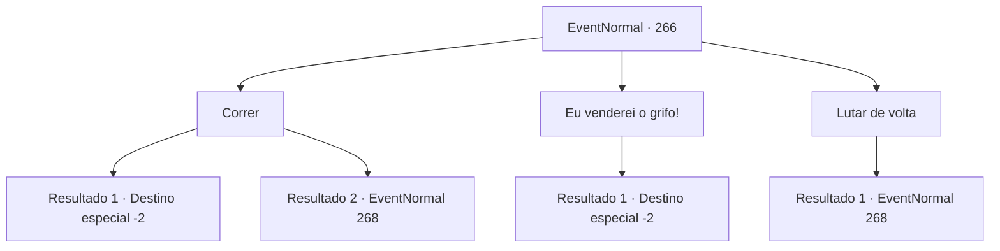

# Eventos normais · 266

[Índice da tabela](index.md) · [Índice geral](../index.md)

ID: `pt:EventNormal:266` · Fonte: `EventNormal4` · Versão: 1.2.47.

Mapeamento estático dos arquivos; a disponibilidade e a execução dependem do estado da run.

## Texto do evento

*Sem texto no arquivo.*

## Dados de entrada

```json
{
  "id": 266,
  "grade": 1,
  "place": "",
  "required": ""
}
```

## Mapa das escolhas



## Escolhas e resultados

### Escolha 1

Correr

Requisitos e outros campos da escolha:

```json
{
  "required": ""
}
```

#### Resultado 1.1

Você corre com toda sua energia, segurando o grifo em seus braços. O homem com vestes de seda e seu guarda costas perseguem você, mas eventualmente perdem o rastro. Talvez o grifo saiba que você está o protegendo, ao esfregar o bico na sua bochecha.

Continuação registrada: [Destino especial `-2`](../destinos-especiais.md).

```json
{
  "required": "",
  "chance": "1|0_6_1",
  "nextEvent": -2,
  "type": 0,
  "reward": "0_2_1|5_180_4"
}
```

#### Resultado 1.2

Você corre com toda sua energia segurando o grifo em seus braços mas o guarda costas te alcança. Ele saca a espada e a sacode em sua direção.

Continuação registrada: [Evento 268](0268.md) na mesma tabela.

```json
{
  "required": "",
  "chance": "13",
  "nextEvent": 268,
  "type": 1,
  "reward": "6_0_92",
  "place": 0
}
```

### Escolha 2

Eu venderei o grifo!

Requisitos e outros campos da escolha:

```json
{
  "required": ""
}
```

#### Resultado 2.1

Você o entrega o bebê grifo. O bebê grifo vira a cabeça de um lado para o outro, como se não entendesse o que está acontecendo. 

 "Hmph... obrigado por reconsiderar. Não se preocupe sobre cuidar dele. Eu o criarei com todo meu coração."

 Ele põe um sorriso satisfeito, olhando para o bebê grifo em seus braços. Ele então retorna ao vagão e parte.

Continuação registrada: [Destino especial `-2`](../destinos-especiais.md).

```json
{
  "required": "",
  "chance": "1",
  "nextEvent": -2,
  "type": 2,
  "reward": "4_203_1|5_180_3|0_4_200"
}
```

### Escolha 3

Lutar de volta

Requisitos e outros campos da escolha:

```json
{
  "required": ""
}
```

#### Resultado 3.1

Você coloca o grifo de volta na bolsa, e silenciosamente saca sua arma.

Continuação registrada: [Evento 268](0268.md) na mesma tabela.

```json
{
  "required": "",
  "chance": "1",
  "nextEvent": 268,
  "type": 2,
  "reward": "6_0_92",
  "place": 0
}
```

## Referências que chegam a este evento

- [Evento 265 · escolha 2 · resultado 1](0265.md#escolha-2)
- [Evento 265 · escolha 3 · resultado 2](0265.md#escolha-3)
- [Evento 267 · escolha 1 · resultado 1](0267.md#escolha-1)
