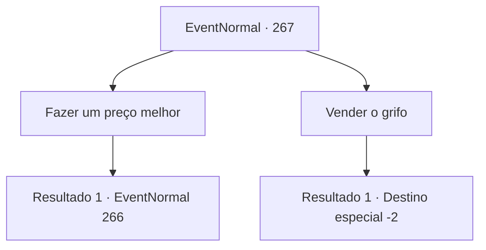

# Eventos normais · 267

[Índice da tabela](index.md) · [Índice geral](../index.md)

ID: `pt:EventNormal:267` · Fonte: `EventNormal4` · Versão: 1.2.47.

Mapeamento estático dos arquivos; a disponibilidade e a execução dependem do estado da run.

## Texto do evento

*Sem texto no arquivo.*

## Dados de entrada

```json
{
  "id": 267,
  "grade": 1,
  "place": "",
  "required": ""
}
```

## Mapa das escolhas



## Escolhas e resultados

### Escolha 1

Fazer um preço melhor

Requisitos e outros campos da escolha:

```json
{
  "required": ""
}
```

#### Resultado 1.1

Você diz ao homem com vestes de seda que o ouro ainda não é suficiente. Você também acrescenta que a não ser que ele aumente o preço, ele não pode ter o grifo. Ele rumina 'Hmm...' por um segundo e após uma breve consideração, fala de novo. 

 "Então... que tal isso? Se você derrotar meu guarda costas numa luta, então eu desistirei do grifo. E claro que essa é uma oferta que você não pode recusar."

 Ao gesticular com a mão, o guia do vagão desce de seu assento. Então ele saca sua espada.

Continuação registrada: [Evento 266](0266.md) na mesma tabela.

```json
{
  "required": "",
  "chance": "1",
  "nextEvent": 266,
  "type": 2,
  "reward": ""
}
```

### Escolha 2

Vender o grifo

Requisitos e outros campos da escolha:

```json
{
  "required": ""
}
```

#### Resultado 2.1

Você vende o bebê grifo por 250 moedas de ouro. O bebê grifo vira a cabeça de um lado para o outro, como se não entendesse o que está acontecendo. 

 "Muitíssimo obrigado! Não se preocupe sobre cuidar dele. Eu o criarei com todo meu coração."

 Ele põe um sorriso satisfeito, olhando para o bebê grifo em seus braços. Ele então retorna ao vagão e parte.

Continuação registrada: [Destino especial `-2`](../destinos-especiais.md).

```json
{
  "required": "",
  "chance": "1",
  "nextEvent": -2,
  "type": 2,
  "reward": "4_203_1|0_4_250|5_180_3"
}
```

## Referências que chegam a este evento

- [Evento 265 · escolha 3 · resultado 1](0265.md#escolha-3)
