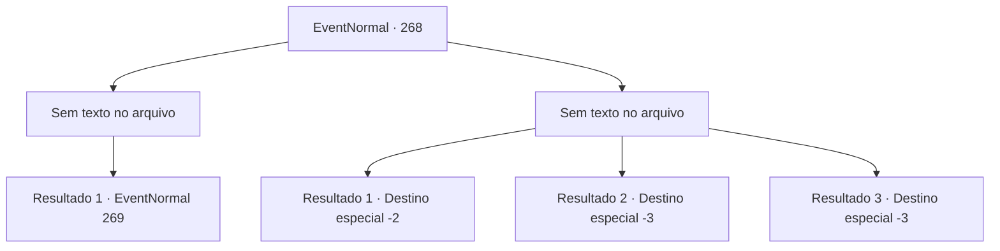

# Eventos normais · 268

[Índice da tabela](index.md) · [Índice geral](../index.md)

ID: `pt:EventNormal:268` · Fonte: `EventNormal4` · Versão: 1.2.47.

Mapeamento estático dos arquivos; a disponibilidade e a execução dependem do estado da run.

## Texto do evento

*Sem texto no arquivo.*

## Dados de entrada

```json
{
  "id": 268,
  "grade": 1,
  "place": "",
  "required": ""
}
```

## Mapa das escolhas



## Escolhas e resultados

### Escolha 1

*Sem texto no arquivo; o papel dessa opção depende da interface do jogo.*

Requisitos e outros campos da escolha:

```json
{
  "required": ""
}
```

#### Resultado 1.1

Você derrota o guarda costas facilmente. O homem com vestes de seda estala a língua, lamentando. 

 "Tss... Que pena. Você venceu. Um trato é um trato. Eu desistirei do grifo, de forma justa."

 Ele ordena o guarda costas a se levantar, então ele volta ao vagão e fecha a porta.

Continuação registrada: [Evento 269](0269.md) na mesma tabela.

```json
{
  "required": "",
  "chance": "1",
  "nextEvent": 269,
  "type": 2,
  "reward": ""
}
```

### Escolha 2

*Sem texto no arquivo; o papel dessa opção depende da interface do jogo.*

Requisitos e outros campos da escolha:

```json
{
  "required": ""
}
```

#### Resultado 2.1

Você é vencido pelo guarda costas, e perde o bebê grifo. O bebê grifo vira a cabeça de um lado para o outro, como se não entendesse o que está acontecendo. 

 "Você podia ter me escutado antes! Não se preocupe sobre cuidar dele. Eu o criarei com todo meu coração."

 Ele põe um sorriso satisfeito, olhando para o bebê grifo em seus braços. Ele então retorna ao vagão e parte.

Continuação registrada: [Destino especial `-2`](../destinos-especiais.md).

```json
{
  "required": "1_0_2|1_1_2",
  "chance": "1",
  "nextEvent": -2,
  "type": 2,
  "reward": "0_0_-1|0_1_-1|4_203_1|5_180_3"
}
```

#### Resultado 2.2

Você é morto pela lâmina do guarda costas. Você dá uma última olhada para o bebê grifo antes de seus olhos fecharem. O bebê grifo chora tristemente, olhando para você.

Continuação registrada: [Destino especial `-3`](../destinos-especiais.md).

```json
{
  "required": "2_0_2",
  "chance": "1",
  "nextEvent": -3,
  "type": 2,
  "reward": "0_0_-1|0_1_-1"
}
```

#### Resultado 2.3

Você é morto pela lâmina do guarda costas. Você dá uma última olhada para o bebê grifo antes de seus olhos fecharem. O bebê grifo chora tristemente, olhando para você.

Continuação registrada: [Destino especial `-3`](../destinos-especiais.md).

```json
{
  "required": "2_1_2",
  "chance": "1",
  "nextEvent": -3,
  "type": 2,
  "reward": "0_0_-1|0_1_-1"
}
```

## Referências que chegam a este evento

- [Evento 266 · escolha 1 · resultado 2](0266.md#escolha-1)
- [Evento 266 · escolha 3 · resultado 1](0266.md#escolha-3)
