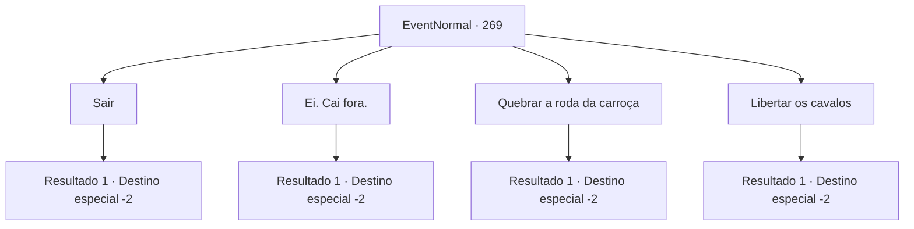

# Eventos normais · 269

[Índice da tabela](index.md) · [Índice geral](../index.md)

ID: `pt:EventNormal:269` · Fonte: `EventNormal4` · Versão: 1.2.47.

Mapeamento estático dos arquivos; a disponibilidade e a execução dependem do estado da run.

## Texto do evento

*Sem texto no arquivo.*

## Dados de entrada

```json
{
  "id": 269,
  "grade": 1,
  "place": "",
  "required": ""
}
```

## Mapa das escolhas



## Escolhas e resultados

### Escolha 1

Sair

Requisitos e outros campos da escolha:

```json
{
  "required": ""
}
```

#### Resultado 1.1

Você deixa para trás o luxuoso vagão, e parte para continuar sua aventura.

Continuação registrada: [Destino especial `-2`](../destinos-especiais.md).

```json
{
  "required": "",
  "chance": "1",
  "nextEvent": -2,
  "type": 2,
  "reward": "5_180_4"
}
```

### Escolha 2

Ei. Cai fora.

Requisitos e outros campos da escolha:

```json
{
  "required": "2_3_0"
}
```

#### Resultado 2.1

Você arromba a porta do vagão. Então você arranca o homem com vestes de seda de dentro do vagão. 

 "O... o que você está fazendo! Você sabe quem sou e...!"

 Ele grita, surpreso, mas suas palavras são interrompidas por você. Você o estapeia na bochecha e o chuta nas canelas. Após mais algumas surras, ele finalmente se desculpa. 

 "Eu estou... terrivelmente arrependido. Apenas me deixe viver, por favor..."

 Ele te entrega uma bolsa pesada recheada de moedas de ouro, e guia ele mesmo o vagão, indo embora 

Continuação registrada: [Destino especial `-2`](../destinos-especiais.md).

```json
{
  "required": "",
  "chance": "1",
  "nextEvent": -2,
  "type": 2,
  "reward": "5_180_4|0_3_-3|0_4_100|0_1_1"
}
```

### Escolha 3

Quebrar a roda da carroça

Requisitos e outros campos da escolha:

```json
{
  "required": ""
}
```

#### Resultado 3.1

Você quebra as rodas do vagão. O vagão perde o equilíbrio e vira para um lado, e como resultado o homem com vestes de seda é jogado para fora do vagão e direto para a lama. 

 "Uck...! Seu... seu bastardo..!!!"

 Você ri alto e foge.

Continuação registrada: [Destino especial `-2`](../destinos-especiais.md).

```json
{
  "required": "",
  "chance": "1",
  "nextEvent": -2,
  "type": 2,
  "reward": "0_1_1|0_3_-1|5_180_4"
}
```

### Escolha 4

Libertar os cavalos

Requisitos e outros campos da escolha:

```json
{
  "required": ""
}
```

#### Resultado 4.1

Você liberta os cavalos acorrentados ao vagão. Então você os chuta nos traseiros com todo seu poder. 

 "*neighhhh*!!"

 Os cavalos saem correndo. O homem com vestes de seda abre a porta do vagão e grita com você. 

 "O que você está fazendo!"

 Você foge rapidamente.

Continuação registrada: [Destino especial `-2`](../destinos-especiais.md).

```json
{
  "required": "",
  "chance": "1",
  "nextEvent": -2,
  "type": 2,
  "reward": "0_1_1|5_180_4"
}
```

## Referências que chegam a este evento

- [Evento 268 · escolha 1 · resultado 1](0268.md#escolha-1)
