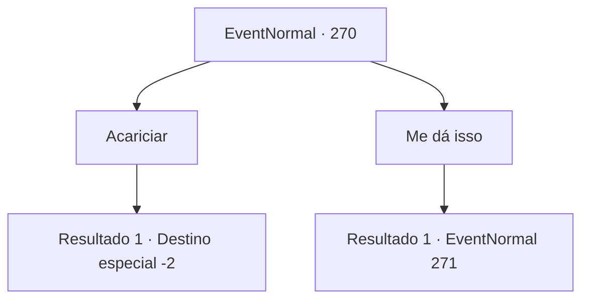

# Eventos normais · 270

[Índice da tabela](index.md) · [Índice geral](../index.md)

ID: `pt:EventNormal:270` · Fonte: `EventNormal4` · Versão: 1.2.47.

Mapeamento estático dos arquivos; a disponibilidade e a execução dependem do estado da run.

## Texto do evento

|drawing_littleGriffin| Sob seus cuidados, o bebê grifo cresceu rapidamente e agora está do tamanho de um grande cão. Agora o grifo é capaz de caçar sozinho e, como se estivesse tentando provar isso, se prepara para comer um salmão que caçou em algum lugar.

## Dados de entrada

```json
{
  "id": 270,
  "grade": 2,
  "place": "",
  "required": "5_180_4|8_203_1"
}
```

## Mapa das escolhas



## Escolhas e resultados

### Escolha 1

Acariciar

Requisitos e outros campos da escolha:

```json
{
  "required": ""
}
```

#### Resultado 1.1

Você gentilmente afaga o grifo. 

 "Grrr...."

 O grifo sorri e rosna alegremente, como se gostasse do seu toque. Então ele engole o salmão que ele pegou, inteiro.

Continuação registrada: [Destino especial `-2`](../destinos-especiais.md).

```json
{
  "required": "",
  "chance": "1",
  "nextEvent": -2,
  "type": 2,
  "reward": "4_203_1|3_204_1"
}
```

### Escolha 2

Me dá isso

Requisitos e outros campos da escolha:

```json
{
  "required": ""
}
```

#### Resultado 2.1

Você gesticula para o grifo te entregar o salmão que ele pegou. Ele põe o salmão em suas mãos, e olha para você.

Continuação registrada: [Evento 271](0271.md) na mesma tabela.

```json
{
  "required": "",
  "chance": "1",
  "nextEvent": 271,
  "type": 2,
  "reward": "4_203_1|3_204_1|3_144_1"
}
```

## Referências que chegam a este evento

Nenhum `nextEvent` positivo da mesma tabela aponta para este nó. Isso não prova que seja inacessível: sorteio e estado de história podem selecioná-lo.

