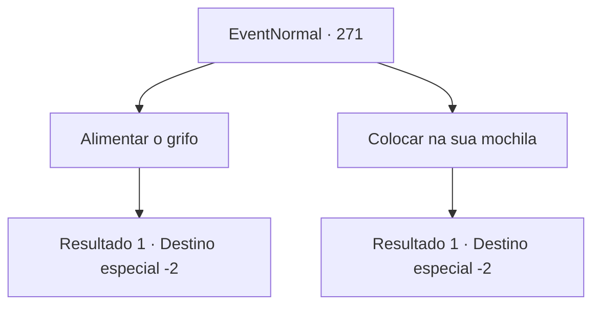

# Eventos normais · 271

[Índice da tabela](index.md) · [Índice geral](../index.md)

ID: `pt:EventNormal:271` · Fonte: `EventNormal4` · Versão: 1.2.47.

Mapeamento estático dos arquivos; a disponibilidade e a execução dependem do estado da run.

## Texto do evento

*Sem texto no arquivo.*

## Dados de entrada

```json
{
  "id": 271,
  "grade": 1,
  "place": "",
  "required": ""
}
```

## Mapa das escolhas



## Escolhas e resultados

### Escolha 1

Alimentar o grifo

Requisitos e outros campos da escolha:

```json
{
  "required": ""
}
```

#### Resultado 1.1

Quando você joga o salmão para ele, o grifo sorri felizmente e o engole inteiro. Então ele balança a cauda lentamente, como se estivesse feliz.

Continuação registrada: [Destino especial `-2`](../destinos-especiais.md).

```json
{
  "required": "",
  "chance": "1",
  "nextEvent": -2,
  "type": 2,
  "reward": "4_144_1"
}
```

### Escolha 2

Colocar na sua mochila

Requisitos e outros campos da escolha:

```json
{
  "required": ""
}
```

#### Resultado 2.1

Você põe o salmão em sua bolsa. O grifo arrasta a cauda pelo chão, como se estivesse um pouco triste.

Continuação registrada: [Destino especial `-2`](../destinos-especiais.md).

```json
{
  "required": "",
  "chance": "1",
  "nextEvent": -2,
  "type": 2,
  "reward": "0_3_-1"
}
```

## Referências que chegam a este evento

- [Evento 270 · escolha 2 · resultado 1](0270.md#escolha-2)
