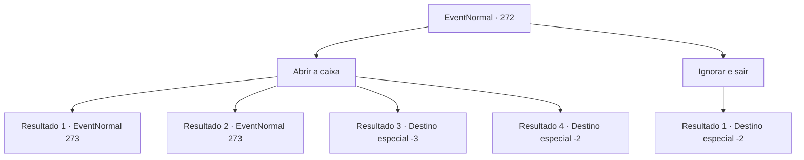

# Eventos normais · 272

[Índice da tabela](index.md) · [Índice geral](../index.md)

ID: `pt:EventNormal:272` · Fonte: `EventNormal4` · Versão: 1.2.47.

Mapeamento estático dos arquivos; a disponibilidade e a execução dependem do estado da run.

## Texto do evento

*Sem texto no arquivo.*

## Dados de entrada

```json
{
  "id": 272,
  "grade": 1,
  "place": "",
  "required": ""
}
```

## Mapa das escolhas



## Escolhas e resultados

### Escolha 1

Abrir a caixa

Requisitos e outros campos da escolha:

```json
{
  "required": ""
}
```

#### Resultado 1.1

Você se aproxima do baú, para abri-lo.

Continuação registrada: [Evento 273](0273.md) na mesma tabela.

```json
{
  "required": "",
  "chance": "1|0_6_1",
  "nextEvent": 273,
  "type": 0,
  "reward": "6_0_100",
  "place": 7
}
```

#### Resultado 1.2

Você se aproxima do baú para abri-lo. Mas então, a caixa abre a boca escancarada e avança em você. Ele não é um baú de tesouro normal, é um mímico. Você tenta recuar, mas o ataque do mímico é mais rápido que você.
 'Creak Creak Creak'
 Como se estivesse feliz pela carne que arrancou de você, ele está fazendo barulhos de rangido.

Continuação registrada: [Evento 273](0273.md) na mesma tabela.

```json
{
  "required": "1_0_2",
  "chance": "11",
  "nextEvent": 273,
  "type": 1,
  "reward": "6_0_100|0_0_-1",
  "place": 7
}
```

#### Resultado 1.3

Você se aproxima do baú para abri-lo. Mas então, a caixa abre a boca escancarada e avança em você. Ele não é um baú de tesouro normal, é um mímico. Você tenta recuar, mas o ataque do mímico é mais rápido que você. O mímico te engole inteiro.

Continuação registrada: [Destino especial `-3`](../destinos-especiais.md).

```json
{
  "required": "2_0_2",
  "chance": "11",
  "nextEvent": -3,
  "type": 1,
  "reward": "0_0_-1"
}
```

#### Resultado 1.4

Você abre o baú de tesouro, dentro há agum ouro e uma poção, aparentemente destinados à outra pessoa. Você os pega e sai da fortaleza abandonada.

Continuação registrada: [Destino especial `-2`](../destinos-especiais.md).

```json
{
  "required": "",
  "chance": "11",
  "nextEvent": -2,
  "type": 2,
  "reward": "3_190_1|3_191_1|0_4_50|5_195_1"
}
```

### Escolha 2

Ignorar e sair

Requisitos e outros campos da escolha:

```json
{
  "required": ""
}
```

#### Resultado 2.1

Você ignora o baú que você achou e parte para fora da fortaleza.

Continuação registrada: [Destino especial `-2`](../destinos-especiais.md).

```json
{
  "required": "",
  "chance": "1",
  "nextEvent": -2,
  "type": 2,
  "reward": "5_195_1"
}
```

## Referências que chegam a este evento

- [Evento 13 · escolha 2 · resultado 2](0013.md#escolha-2)
- [Evento 13 · escolha 3 · resultado 2](0013.md#escolha-3)
- [Evento 14 · escolha 1 · resultado 2](0014.md#escolha-1)
