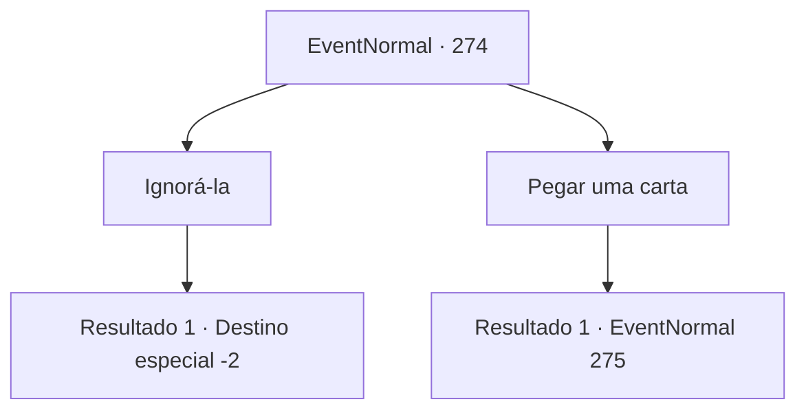

# Eventos normais · 274

[Índice da tabela](index.md) · [Índice geral](../index.md)

ID: `pt:EventNormal:274` · Fonte: `EventNormal4` · Versão: 1.2.47.

Mapeamento estático dos arquivos; a disponibilidade e a execução dependem do estado da run.

## Texto do evento

Enquanto você está vagando por uma cidade, você encontra uma velha bruxa com um de seus olhos totalmente branco, nos cantos do mercado. Ela fala com você, embaralhando as cartas na mesa. 

 "Você deseja saber seu destino? Então, escolha um cartão. 10 ouros pelo resultado."


## Dados de entrada

```json
{
  "id": 274,
  "grade": 1,
  "place": "",
  "required": "5_188_0|2_2_40"
}
```

## Mapa das escolhas



## Escolhas e resultados

### Escolha 1

Ignorá-la

Requisitos e outros campos da escolha:

```json
{
  "required": ""
}
```

#### Resultado 1.1

Você ignora a velha bruxa e vai embora.

Continuação registrada: [Destino especial `-2`](../destinos-especiais.md).

```json
{
  "required": "",
  "chance": "1",
  "nextEvent": -2,
  "type": 2,
  "reward": "5_188_9"
}
```

### Escolha 2

Pegar uma carta

Requisitos e outros campos da escolha:

```json
{
  "required": "1_4_10"
}
```

#### Resultado 2.1

Você pega uma carta como a velha bruxa diz. Ela bota a mão dela em cima da sua, e continua com uma voz rachada. 

 "Essa não é uma simples carta. Ela possui a chave para cada e todo segredo do universo. Dependendo do resultado, suas capacidade podem passar por uma mudança."

 A bruxa lentamente tira a mão dela da sua, ainda te encarando nos olhos. Então ela gesticula para que você revele a carta, que, para sua surpresa e desapontamento, está vazia. Quando você a pergunta o porquê da carta não ter nada nela, a bruxa sorri quietamente. 

 "Oh, você logo verá o que aparece na carta. Agora, vire a carta para baixo de novo, para que você não veja a frente dela."

 Ao obedecer os comandos sinistros dela e virar a carta para baixo, a bruxa faz uma pergunta diferente dessa vez. 

 "Eu vou te perguntar uma coisa antes de você abrir a carta novamente. Qual é a coisa mais importante da sua vida?"


Continuação registrada: [Evento 275](0275.md) na mesma tabela.

```json
{
  "required": "",
  "chance": "1",
  "nextEvent": 275,
  "type": 2,
  "reward": ""
}
```

## Referências que chegam a este evento

Nenhum `nextEvent` positivo da mesma tabela aponta para este nó. Isso não prova que seja inacessível: sorteio e estado de história podem selecioná-lo.

