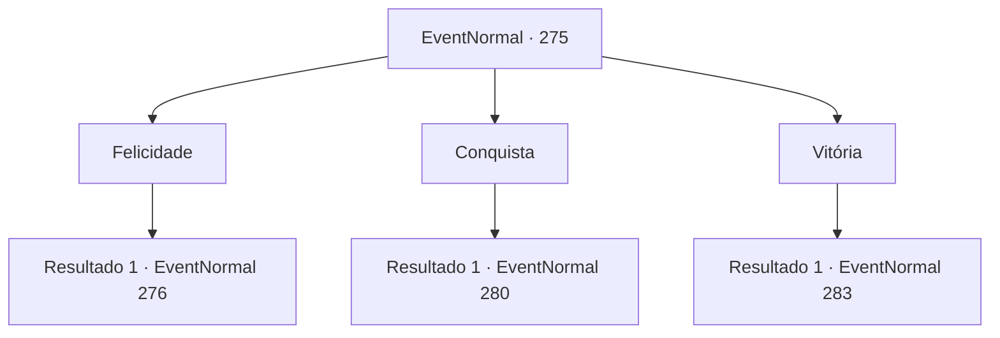

# Eventos normais · 275

[Índice da tabela](index.md) · [Índice geral](../index.md)

ID: `pt:EventNormal:275` · Fonte: `EventNormal4` · Versão: 1.2.47.

Mapeamento estático dos arquivos; a disponibilidade e a execução dependem do estado da run.

## Texto do evento

*Sem texto no arquivo.*

## Dados de entrada

```json
{
  "id": 275,
  "grade": 1,
  "place": "",
  "required": ""
}
```

## Mapa das escolhas



## Escolhas e resultados

### Escolha 1

Felicidade

Requisitos e outros campos da escolha:

```json
{
  "required": ""
}
```

#### Resultado 1.1

Você a diz que ser feliz é a coisa mais importante. Não importa o que você faça, nada importa se você não está feliz. Após quietamente te ouvir por um tempo, a bruxa gesticula para você abrir a carta novamente. Ao cuidadosamente abrir a carta de novo, um desenho, embora embaçado, aparece. Você a põe para baixo novamente, após a olhar por um tempo. 

 "Vamos falar mais. O desenho na carta ficará mais claro. Então, o que é preciso para alcancar essa suposta felicidade?"

 Perguntando a você uma pergunta ainda mais complicada, a bruxa aguarda a sua resposta.

Continuação registrada: [Evento 276](0276.md) na mesma tabela.

```json
{
  "required": "",
  "chance": "1",
  "nextEvent": 276,
  "type": 2,
  "reward": ""
}
```

### Escolha 2

Conquista

Requisitos e outros campos da escolha:

```json
{
  "required": ""
}
```

#### Resultado 2.1

Você a diz que conquista é a coisa mais importante. A vida seria uma falha se o resultado final é ruim, não importa o quão excelente seja o processo. Após quietamente te ouvir por um tempo, a bruxa gesticula para você abrir a carta novamente. Ao cuidadosamente abrir a carta de novo, um desenho, embora embaçado, aparece. Você a põe para baixo novamente, após a olhar por um tempo. 

 "Vamos falar mais. O desenho na carta ficará mais claro. Então, o que é preciso para ser bem sucedido?"

 Perguntando a você uma pergunta ainda mais complicada, a bruxa aguarda a sua resposta.

Continuação registrada: [Evento 280](0280.md) na mesma tabela.

```json
{
  "required": "",
  "chance": "1",
  "nextEvent": 280,
  "type": 2,
  "reward": ""
}
```

### Escolha 3

Vitória

Requisitos e outros campos da escolha:

```json
{
  "required": ""
}
```

#### Resultado 3.1

Você a diz que sair vitorioso é a coisa mais importante. Você afirma que derrotar seu oponente é o grande valor da vida, seja uma pessoa, um indivíduo, um grupo, independente de como você os derrota. A bruxa põe um estranho sorriso e continua. 

 "Vamos falar mais. O desenho na carta ficará mais claro. Então, o que é preciso para ser vitorioso?"

 Perguntando a você uma pergunta ainda mais complicada, a bruxa aguarda a sua resposta.

Continuação registrada: [Evento 283](0283.md) na mesma tabela.

```json
{
  "required": "",
  "chance": "1",
  "nextEvent": 283,
  "type": 2,
  "reward": ""
}
```

## Referências que chegam a este evento

- [Evento 274 · escolha 2 · resultado 1](0274.md#escolha-2)
