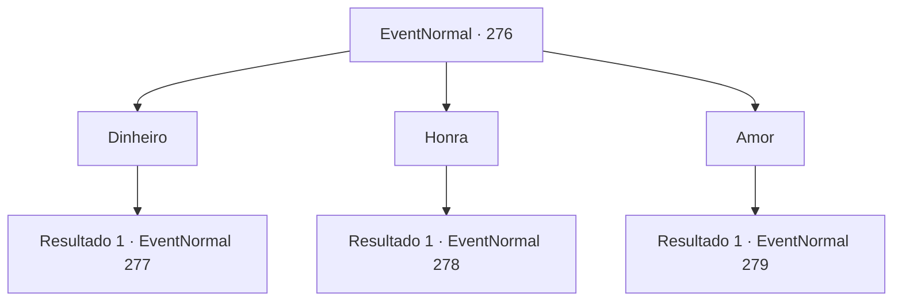

# Eventos normais · 276

[Índice da tabela](index.md) · [Índice geral](../index.md)

ID: `pt:EventNormal:276` · Fonte: `EventNormal4` · Versão: 1.2.47.

Mapeamento estático dos arquivos; a disponibilidade e a execução dependem do estado da run.

## Texto do evento

*Sem texto no arquivo.*

## Dados de entrada

```json
{
  "id": 276,
  "grade": 1,
  "place": "",
  "required": ""
}
```

## Mapa das escolhas



## Escolhas e resultados

### Escolha 1

Dinheiro

Requisitos e outros campos da escolha:

```json
{
  "required": ""
}
```

#### Resultado 1.1

Você a diz que dinheiro é a coisa mais importante quando se trata de ser feliz. Embora você possa nem sempre ser feliz com muito dinheiro, você certamente será infeliz sem dinheiro nenhum. A bruxa põe um sorriso estranho e continua. 

 "Vamos falar mais. O desenho na carta ficará mais claro. Então, o que é preciso para ficar rico?"

 Perguntando a você uma pergunta ainda mais complicada, a bruxa aguarda a sua resposta.

Continuação registrada: [Evento 277](0277.md) na mesma tabela.

```json
{
  "required": "",
  "chance": "1",
  "nextEvent": 277,
  "type": 2,
  "reward": ""
}
```

### Escolha 2

Honra

Requisitos e outros campos da escolha:

```json
{
  "required": ""
}
```

#### Resultado 2.1

Você a diz que honra é a coisa mais importante quando se trata de ser feliz. Se você não vive uma voda honrosa, você sentirá vergonha de si mesmo e nunca será verdadeiramente feliz. A bruxa põe um sorriso estranho e continua. 

 "Vamos falar mais. O desenho na carta ficará mais claro. Então, o que é preciso para se tornar honroso?"

 Perguntando a você uma pergunta ainda mais complicada, a bruxa aguarda a sua resposta.

Continuação registrada: [Evento 278](0278.md) na mesma tabela.

```json
{
  "required": "",
  "chance": "1",
  "nextEvent": 278,
  "type": 2,
  "reward": ""
}
```

### Escolha 3

Amor

Requisitos e outros campos da escolha:

```json
{
  "required": ""
}
```

#### Resultado 3.1

Você a diz que amor é a coisa mais importante quando se trata de ser feliz. Não importa o quão grandiosa seja sua conquista, você nunca será feliz sem alguém amado. A bruxa põe um sorriso estranho e continua. 

 "Vamos falar mais. O desenho na carta ficará mais claro. Então, o que é preciso para encontrar amor?"

 Perguntando a você uma pergunta ainda mais complicada, a bruxa aguarda a sua resposta.

Continuação registrada: [Evento 279](0279.md) na mesma tabela.

```json
{
  "required": "",
  "chance": "1",
  "nextEvent": 279,
  "type": 2,
  "reward": ""
}
```

## Referências que chegam a este evento

- [Evento 275 · escolha 1 · resultado 1](0275.md#escolha-1)
