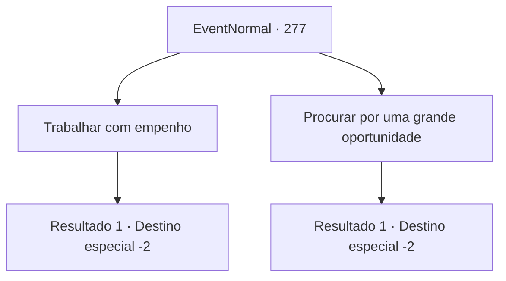

# Eventos normais · 277

[Índice da tabela](index.md) · [Índice geral](../index.md)

ID: `pt:EventNormal:277` · Fonte: `EventNormal4` · Versão: 1.2.47.

Mapeamento estático dos arquivos; a disponibilidade e a execução dependem do estado da run.

## Texto do evento

*Sem texto no arquivo.*

## Dados de entrada

```json
{
  "id": 277,
  "grade": 1,
  "place": "",
  "required": ""
}
```

## Mapa das escolhas



## Escolhas e resultados

### Escolha 1

Trabalhar com empenho

Requisitos e outros campos da escolha:

```json
{
  "required": ""
}
```

#### Resultado 1.1

Você a diz que você tem que trabalhar diligentemente. Procurar uma grande oportunidade é uma opção válida, mas se você continuar trabalhando o dinheiro vai te seguir naturalmente. A velha bruxa gesticula para você abrir a carta mais uma vez. Lendo a deixa dela, você abre a carta de novo, e uma luz deslumbrante te cega. Ao abrir seus olhos de novo, um desenho de uma carruagem de guerra pode ser visto na carta. 

 "A Carruagem. Isso significa marchar rumo ao seu objetivo, não importa quem ou o que bloqueie o seu caminho. Mas, você deve ter cuidado para não perder o curso de onde você está indo."

 Após terminar, ela silenciosamente ergue a palma da mão. Você a entrega 10 moedas de ouro e segue seu caminho.

Continuação registrada: [Destino especial `-2`](../destinos-especiais.md).

```json
{
  "required": "",
  "chance": "1",
  "nextEvent": -2,
  "type": 2,
  "reward": "0_5_1|0_7_-1|0_4_-10|5_188_1"
}
```

### Escolha 2

Procurar por uma grande oportunidade

Requisitos e outros campos da escolha:

```json
{
  "required": ""
}
```

#### Resultado 2.1

Você a diz que você deve procurar por uma grande oportunidade. Alguém pode tentar ganhar a vida trabalhando diligentemente, mas tendo escolhido a vida de aventureiro significava que o verdadeiro método seria desafiar a deusa da sorte. A velha bruxa gesticula para você abrir a carta mais uma vez. Lendo a deixa dela, você abre a carta de novo, e uma luz deslumbrante te cega. Ao abrir os olhos de novo, o desenho de um bobo da corte pode ser visto na carta. 

 "O Tolo. Não muito inteligente, mas nunca hesitante diante de aventuras. Mas tenha em mente. Ignorância nunca é desculpa para falha."

 Após terminar, ela silenciosamente ergue a palma da mão. Você a entrega 10 moedas de ouro e segue seu caminho.

Continuação registrada: [Destino especial `-2`](../destinos-especiais.md).

```json
{
  "required": "",
  "chance": "1",
  "nextEvent": -2,
  "type": 2,
  "reward": "0_6_1|0_14_-1|0_4_-10|5_188_1"
}
```

## Referências que chegam a este evento

- [Evento 276 · escolha 1 · resultado 1](0276.md#escolha-1)
- [Evento 280 · escolha 3 · resultado 1](0280.md#escolha-3)
