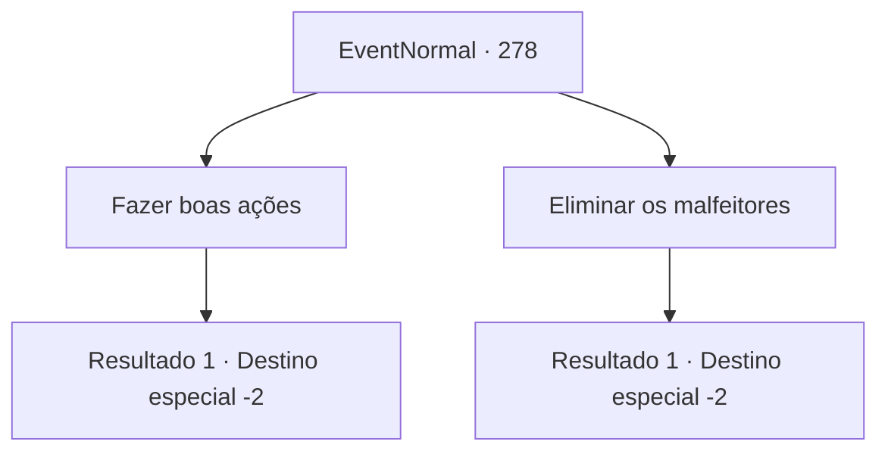

# Eventos normais · 278

[Índice da tabela](index.md) · [Índice geral](../index.md)

ID: `pt:EventNormal:278` · Fonte: `EventNormal4` · Versão: 1.2.47.

Mapeamento estático dos arquivos; a disponibilidade e a execução dependem do estado da run.

## Texto do evento

*Sem texto no arquivo.*

## Dados de entrada

```json
{
  "id": 278,
  "grade": 1,
  "place": "",
  "required": ""
}
```

## Mapa das escolhas



## Escolhas e resultados

### Escolha 1

Fazer boas ações

Requisitos e outros campos da escolha:

```json
{
  "required": "1_3_0"
}
```

#### Resultado 1.1

Você a diz que você deve prover atos de gentileza. Quando ajudar os outros vira um hábito, honra irá te seguir naturalmente. A velha bruxa gesticula para você abrir a carta mais uma vez. Lendo a deixa dela, você abre a carta de novo, e uma luz deslumbrante te cega. Ao abrir os olhos de novo, o desenho de uma dama segurando uma balança e uma espada pode ser visto na carta. 

 "Justiça. Uma carta que simboliza o bem nobre, sempre tentando manter equilíbrio e justiça. Mas lembre-se, assim como os próprios mortais, decisões tomadas pelos mortais nunca serão perfeitas."

 Após terminar, ela silenciosamente ergue a palma da mão. Você a entrega 10 moedas de ouro e segue seu caminho.

Continuação registrada: [Destino especial `-2`](../destinos-especiais.md).

```json
{
  "required": "",
  "chance": "1",
  "nextEvent": -2,
  "type": 2,
  "reward": "0_7_1|0_5_-1|0_4_-10|5_188_1"
}
```

### Escolha 2

Eliminar os malfeitores

Requisitos e outros campos da escolha:

```json
{
  "required": ""
}
```

#### Resultado 2.1

Você a diz que você deve aniquilar todas pessoas más. Ao livrar o mundo daqueles que o tormentam, honra irá te seguir naturalmente. A velha bruxa gesticula para você abrir a carta mais uma vez. Lendo a deixa dela, você abre a carta de novo, e uma luz deslumbrante te cega. Ao abrir os olhos de novo, o desenho de um imperador sentado em um trono pode ser visto na carta. 

 "O Imperador. Simboliza julgamento racional e decisão, e o poder de os julgar. Mas lembre-se, o que você pensa que está certo, pode nem sempre ser o certo."

 Após terminar, ela silenciosamente ergue a palma da mão. Você a entrega 10 moedas de ouro e segue seu caminho.

Continuação registrada: [Destino especial `-2`](../destinos-especiais.md).

```json
{
  "required": "",
  "chance": "1",
  "nextEvent": -2,
  "type": 2,
  "reward": "0_12_1|0_14_-1|0_4_-10|5_188_1"
}
```

## Referências que chegam a este evento

- [Evento 276 · escolha 2 · resultado 1](0276.md#escolha-2)
