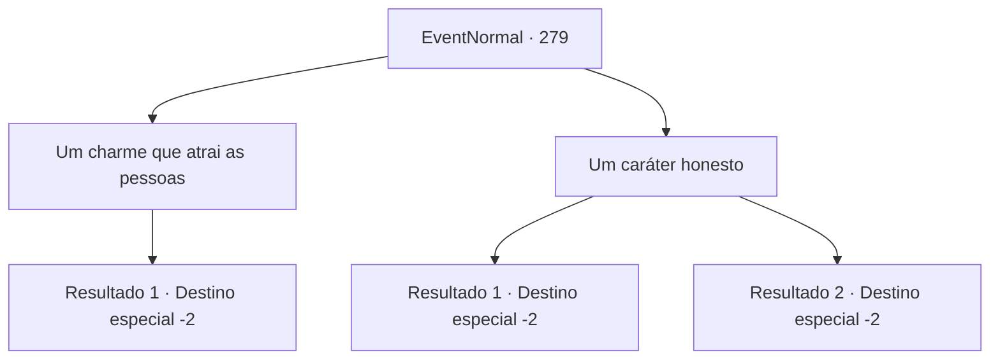

# Eventos normais · 279

[Índice da tabela](index.md) · [Índice geral](../index.md)

ID: `pt:EventNormal:279` · Fonte: `EventNormal4` · Versão: 1.2.47.

Mapeamento estático dos arquivos; a disponibilidade e a execução dependem do estado da run.

## Texto do evento

*Sem texto no arquivo.*

## Dados de entrada

```json
{
  "id": 279,
  "grade": 1,
  "place": "",
  "required": ""
}
```

## Mapa das escolhas



## Escolhas e resultados

### Escolha 1

Um charme que atrai as pessoas

Requisitos e outros campos da escolha:

```json
{
  "required": ""
}
```

#### Resultado 1.1

Você a diz que charme pessoal é a solução mais efetiva, desde que tendo tal qualidade fará qualquer conquista sua maior, e seus erros facilmente perdoáveis. A velha bruxa gesticula para você abrir a carta mais uma vez. Lendo a deixa dela, você abre a carta de novo, e uma luz deslumbrante te cega. Ao abrir os olhos de novo, o desenho de uma mulher com uma brilhante aura divina pode ser visto na carta. 

 "A Alta Sacerdotisa. Isso significa que outras pessoas te seguem, enviando seu suporte espiritual. Mas não vá achando que você é o centro do universo."

 Após terminar, ela silenciosamente ergue a palma da mão. Você a entrega 10 moedas de ouro e segue seu caminho.

Continuação registrada: [Destino especial `-2`](../destinos-especiais.md).

```json
{
  "required": "",
  "chance": "1",
  "nextEvent": -2,
  "type": 2,
  "reward": "0_12_1|0_7_-1|0_4_-10|5_188_1"
}
```

### Escolha 2

Um caráter honesto

Requisitos e outros campos da escolha:

```json
{
  "required": ""
}
```

#### Resultado 2.1

Você a diz que um caráter honesto, moralmente correto é a chave. Vivendo uma vida moralmente correta e não fazendo nada errado vai certamente te fazer ser amado por todos. A velha bruxa gesticula para você abrir a carta mais uma vez. Lendo a deixa dela, você abre a carta de novo, e uma luz deslumbrante te cega. Ao abrir os olhos de novo, o desenho de um um homem velho com roupas extravagantes segurando um cajado pode ser visto na carta. 

 "O Hierofante. Simboliza gentileza, consideração,e altruísmo, Mas o muito de qualquer coisa nunca é bom. Tenha cuidado, e não perca a si mesmo no meio do mundo que te cerca"

 Após terminar, ela silenciosamente ergue a palma da mão. Você a entrega 10 moedas de ouro e segue seu caminho.

Continuação registrada: [Destino especial `-2`](../destinos-especiais.md).

```json
{
  "required": "1_3_10",
  "chance": "1",
  "nextEvent": -2,
  "type": 2,
  "reward": "0_7_1|0_5_-1|0_4_-10|5_188_1"
}
```

#### Resultado 2.2

Você a diz que um caráter honesto, moralmente correto é a chave. Vivendo uma vida moralmente correta e não fazendo nada errado vai certamente te fazer ser amado por todos. A velha bruxa gesticula para você abrir a carta mais uma vez. Lendo a deixa dela, você abre a carta de novo, mas o desenho da carta ainda está embaçado. 

 "Hmph. Parece que suas ações não combinam com suas palavras."

 A bruxa tira a pilha de cartas, e você vira as costas para ela, partindo para outro lugar.

Continuação registrada: [Destino especial `-2`](../destinos-especiais.md).

```json
{
  "required": "2_3_10",
  "chance": "1",
  "nextEvent": -2,
  "type": 2,
  "reward": "5_188_9"
}
```

## Referências que chegam a este evento

- [Evento 276 · escolha 3 · resultado 1](0276.md#escolha-3)
