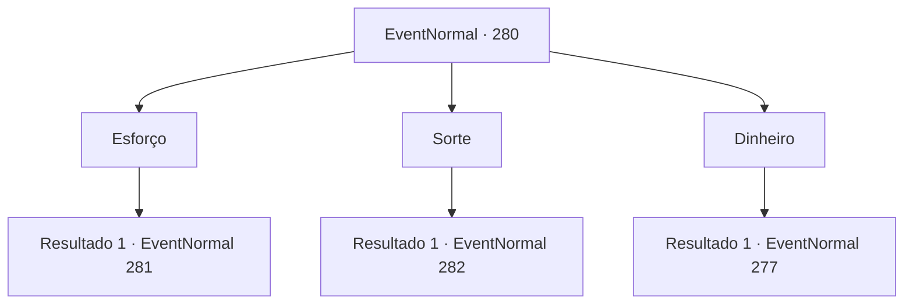

# Eventos normais · 280

[Índice da tabela](index.md) · [Índice geral](../index.md)

ID: `pt:EventNormal:280` · Fonte: `EventNormal4` · Versão: 1.2.47.

Mapeamento estático dos arquivos; a disponibilidade e a execução dependem do estado da run.

## Texto do evento

*Sem texto no arquivo.*

## Dados de entrada

```json
{
  "id": 280,
  "grade": 1,
  "place": "",
  "required": ""
}
```

## Mapa das escolhas



## Escolhas e resultados

### Escolha 1

Esforço

Requisitos e outros campos da escolha:

```json
{
  "required": ""
}
```

#### Resultado 1.1

Você a diz que esforço é a coisa mais importante quando se trata de ser bem sucedido. De todas as pessoas que foram bem sucedidas, não há uma pessoa sequer que não se esforçou. A bruxa põe um sorriso estranho e continua. 

 "Vamos falar mais. O desenho na carta ficará mais claro. Então você está tentando dizer que ao fim de longos caminhos de esforço, sempre haverá uma recompensa?"

 Perguntando a você uma pergunta ainda mais complicada, a bruxa aguarda a sua resposta.

Continuação registrada: [Evento 281](0281.md) na mesma tabela.

```json
{
  "required": "",
  "chance": "1",
  "nextEvent": 281,
  "type": 2,
  "reward": ""
}
```

### Escolha 2

Sorte

Requisitos e outros campos da escolha:

```json
{
  "required": ""
}
```

#### Resultado 2.1

Você a diz que sorte é a coisa mais importante quando se trata de ser bem sucedido. Não importa quanto dinheiro você tem, ou o quanto você se esforçou, não é nada se você não for sortudo. A bruxa põe um sorriso estranho e continua. 

 "Vamos falar mais. O desenho na carta ficará mais claro. Então você está tentando dizer que nós deveríamos viver sem preocupação, deixando tudo à questão da sorte?"

 Perguntando a você uma pergunta ainda mais complicada, a bruxa aguarda a sua resposta.

Continuação registrada: [Evento 282](0282.md) na mesma tabela.

```json
{
  "required": "",
  "chance": "1",
  "nextEvent": 282,
  "type": 2,
  "reward": ""
}
```

### Escolha 3

Dinheiro

Requisitos e outros campos da escolha:

```json
{
  "required": ""
}
```

#### Resultado 3.1

Você a diz que dinheiro é a coisa mais importante quando se trata de ser feliz. Embora você possa nem sempre ser bem sucedido com muito dinheiro, você nunca se recuperará de uma falha se tiver sem dinheiro. A bruxa põe um sorriso estranho e continua. 

 "Vamos falar mais. O desenho na carta ficará mais claro. Então, o que é preciso para ficar rico?"

 Perguntando a você uma pergunta ainda mais complicada, a bruxa aguarda a sua resposta.

Continuação registrada: [Evento 277](0277.md) na mesma tabela.

```json
{
  "required": "",
  "chance": "1",
  "nextEvent": 277,
  "type": 2,
  "reward": ""
}
```

## Referências que chegam a este evento

- [Evento 275 · escolha 2 · resultado 1](0275.md#escolha-2)
