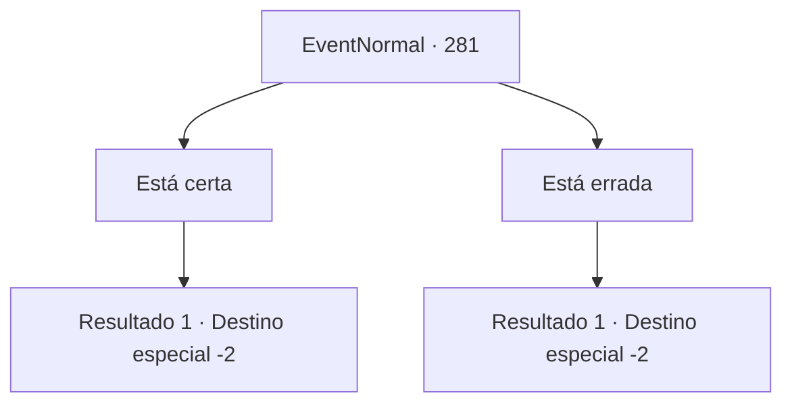

# Eventos normais · 281

[Índice da tabela](index.md) · [Índice geral](../index.md)

ID: `pt:EventNormal:281` · Fonte: `EventNormal4` · Versão: 1.2.47.

Mapeamento estático dos arquivos; a disponibilidade e a execução dependem do estado da run.

## Texto do evento

*Sem texto no arquivo.*

## Dados de entrada

```json
{
  "id": 281,
  "grade": 1,
  "place": "",
  "required": ""
}
```

## Mapa das escolhas



## Escolhas e resultados

### Escolha 1

Está certa

Requisitos e outros campos da escolha:

```json
{
  "required": ""
}
```

#### Resultado 1.1

Você confiantemente responde que sim. Auto-aperfeiçoamento através de esforço nunca falha, e embora seus efeitos possam não ser imediatos, um dia o resultado acumulado vai começar a aparecer. A velha bruxa gesticula para você abrir a carta mais uma vez. Lendo a deixa dela, você abre a carta de novo, e uma luz deslumbrante te cega. Ao abrir os olhos de novo, o desenho de uma mulher com uma brilhante aura divina pode ser visto na carta. 

 "O Eremita. Aquele que quietamente aprimora suas habilidades em isolamento... mas quando a hora chega, deve se revelar para o mundo."

 Após terminar, ela silenciosamente ergue a palma da mão. Você a entrega 10 moedas de ouro e segue seu caminho.

Continuação registrada: [Destino especial `-2`](../destinos-especiais.md).

```json
{
  "required": "",
  "chance": "1",
  "nextEvent": -2,
  "type": 2,
  "reward": "0_14_1|0_6_-1|0_4_-10|5_188_1"
}
```

### Escolha 2

Está errada

Requisitos e outros campos da escolha:

```json
{
  "required": ""
}
```

#### Resultado 2.1

Você balança a cabeça, respondendo que não. Esforço nem sempre é recompensado com um resultado, mas você ainda acredita que é importante, continuar o processo de se esforçar e desafiar a si mesmo. A velha bruxa gesticula para você abrir a carta mais uma vez. Lendo a deixa dela, você abre a carta de novo, e uma luz deslumbrante te cega. Ao abrir os olhos de novo, o desenho de um homem enforcado por uma corda pode ser visto na carta. 

 "O Homem Enforcado. Isso significa que você está pronto para se sacrificar. Contudo, espero que valha a pena."

 Após terminar, ela silenciosamente ergue a palma da mão. Você a entrega 10 moedas de ouro e segue seu caminho.

Continuação registrada: [Destino especial `-2`](../destinos-especiais.md).

```json
{
  "required": "",
  "chance": "1",
  "nextEvent": -2,
  "type": 2,
  "reward": "0_13_1|0_14_-1|0_4_-10|5_188_1"
}
```

## Referências que chegam a este evento

- [Evento 280 · escolha 1 · resultado 1](0280.md#escolha-1)
- [Evento 283 · escolha 1 · resultado 1](0283.md#escolha-1)
