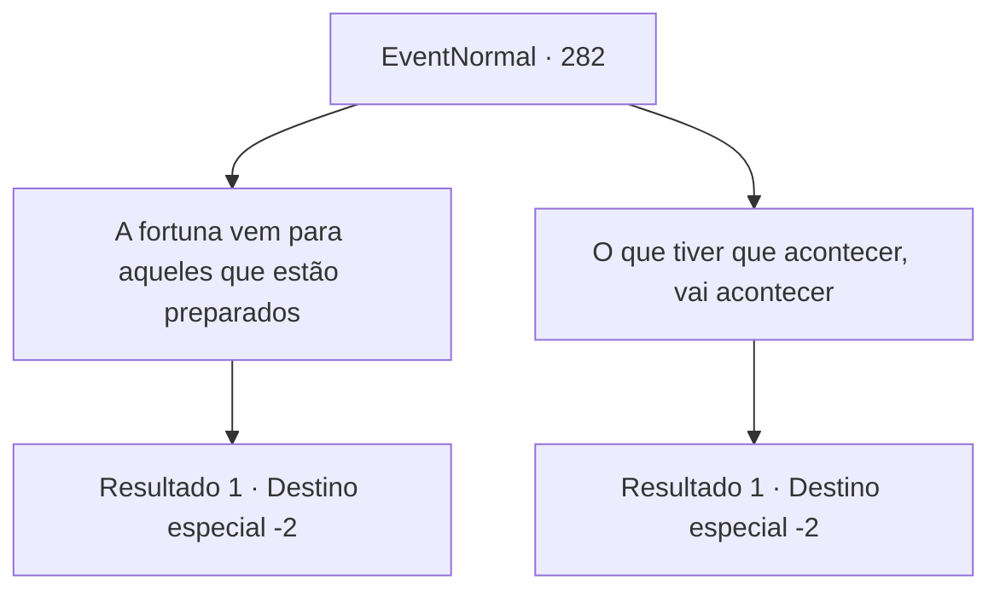

# Eventos normais · 282

[Índice da tabela](index.md) · [Índice geral](../index.md)

ID: `pt:EventNormal:282` · Fonte: `EventNormal4` · Versão: 1.2.47.

Mapeamento estático dos arquivos; a disponibilidade e a execução dependem do estado da run.

## Texto do evento

*Sem texto no arquivo.*

## Dados de entrada

```json
{
  "id": 282,
  "grade": 1,
  "place": "",
  "required": ""
}
```

## Mapa das escolhas



## Escolhas e resultados

### Escolha 1

A fortuna vem para aqueles que estão preparados

Requisitos e outros campos da escolha:

```json
{
  "required": ""
}
```

#### Resultado 1.1

Você balança a cabeça, dizendo que fortuna só vem para aqueles que estão preparados. O truque é não meramente esperar pela fortuna vir em vão, sem qualquer esforço, mas sim continuar melhorando, esperando pelo momento perfeito para que você a agarre apropriadamente. A velha bruxa gesticula para você abrir a carta mais uma vez. Lendo a deixa dela, você abre a carta de novo, e uma luz deslumbrante te cega. Ao abrir os olhos de novo, o desenho de uma mulher e um leão pode ser visto na carta. 

 "Força. Isso significa que você está preparado para qualquer ameaça que possa vir à você, sem fugir. Mas lembre-se. Recorrer à temerariedade não é coragem, mas sim ignorância e imprudência."

 Após terminar, ela silenciosamente ergue a palma da mão. Você a entrega 10 moedas de ouro e segue seu caminho.

Continuação registrada: [Destino especial `-2`](../destinos-especiais.md).

```json
{
  "required": "",
  "chance": "1",
  "nextEvent": -2,
  "type": 2,
  "reward": "0_5_1|0_14_-1|0_4_-10|5_188_1"
}
```

### Escolha 2

O que tiver que acontecer, vai acontecer

Requisitos e outros campos da escolha:

```json
{
  "required": ""
}
```

#### Resultado 2.1

Você a diz que vida sempe segue o determinado caminho do destino. Não importa o quão grande é o esforço, a consequência de qualquer tentativa é decidido por um resultado de um divino rolar de dados. A velha bruxa gesticula para você abrir a carta mais uma vez. Lendo a deixa dela, você abre a carta de novo, e uma luz deslumbrante te cega. Ao abrir os olhos de novo, o desenho de um carrinho flutuando pelo ar pode ser visto na carta. 

 "Roda da Fortuna. Isso simboliza a circulação do destino. Eu espero que você agarre a oportunidade quando ela aparecer para você."

 Após terminar, ela silenciosamente ergue a palma da mão. Você a entrega 10 moedas de ouro e segue seu caminho.

Continuação registrada: [Destino especial `-2`](../destinos-especiais.md).

```json
{
  "required": "",
  "chance": "1",
  "nextEvent": -2,
  "type": 2,
  "reward": "0_14_1|0_13_-1|0_4_-10|5_188_1"
}
```

## Referências que chegam a este evento

- [Evento 280 · escolha 2 · resultado 1](0280.md#escolha-2)
