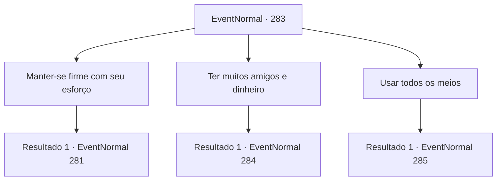

# Eventos normais · 283

[Índice da tabela](index.md) · [Índice geral](../index.md)

ID: `pt:EventNormal:283` · Fonte: `EventNormal4` · Versão: 1.2.47.

Mapeamento estático dos arquivos; a disponibilidade e a execução dependem do estado da run.

## Texto do evento

*Sem texto no arquivo.*

## Dados de entrada

```json
{
  "id": 283,
  "grade": 1,
  "place": "",
  "required": ""
}
```

## Mapa das escolhas



## Escolhas e resultados

### Escolha 1

Manter-se firme com seu esforço

Requisitos e outros campos da escolha:

```json
{
  "required": ""
}
```

#### Resultado 1.1

Você a diz que o único jeito é se esforçar, se esforçar e se esforçar. Após suportar um longo e duro tempo de dificuldade, certamente haverá uma recompensa. A bruxa põe um sorriso estranho e continua. 

 "Vamos falar mais. O desenho na carta ficará mais claro. Então você está tentando dizer que ao fim de longos caminhos de esforço, sempre haverá uma recompensa?"

 Perguntando a você uma pergunta ainda mais complicada, a bruxa aguarda a sua resposta.

Continuação registrada: [Evento 281](0281.md) na mesma tabela.

```json
{
  "required": "",
  "chance": "1",
  "nextEvent": 281,
  "type": 2,
  "reward": ""
}
```

### Escolha 2

Ter muitos amigos e dinheiro

Requisitos e outros campos da escolha:

```json
{
  "required": ""
}
```

#### Resultado 2.1

Você a diz que as capacidades de um indivíduo tem limites, e a verdadeira chave para vitória é a habilidade de pegar emprestada ou comprar a capacidade de outras pessoas. A bruxa põe um sorriso estranho e continua. 

 "Vamos falar mais. O desenho na carta ficará mais claro. Então você está tentando dizer que aqueles sem dinheiro e conexões humanas estão presos à vida de perdedores?"

 Perguntando a você uma pergunta ainda mais complicada, a bruxa aguarda a sua resposta.

Continuação registrada: [Evento 284](0284.md) na mesma tabela.

```json
{
  "required": "",
  "chance": "1",
  "nextEvent": 284,
  "type": 2,
  "reward": ""
}
```

### Escolha 3

Usar todos os meios

Requisitos e outros campos da escolha:

```json
{
  "required": ""
}
```

#### Resultado 3.1

Você a diz que você não deveria hesitar em usar quaisquer meios. Aqueles que gritam justiça, falando sobre leis e moralidade não passam de perdedores. A bruxa põe um sorriso estranho e continua. 

 "Vamos falar mais. O desenho na carta ficará mais claro. Então você está tentando dizer que todos valores exceto vitória não passam de ilusões?"

 Perguntando a você uma pergunta ainda mais complicada, a bruxa aguarda a sua resposta.

Continuação registrada: [Evento 285](0285.md) na mesma tabela.

```json
{
  "required": "",
  "chance": "1",
  "nextEvent": 285,
  "type": 2,
  "reward": ""
}
```

## Referências que chegam a este evento

- [Evento 275 · escolha 3 · resultado 1](0275.md#escolha-3)
