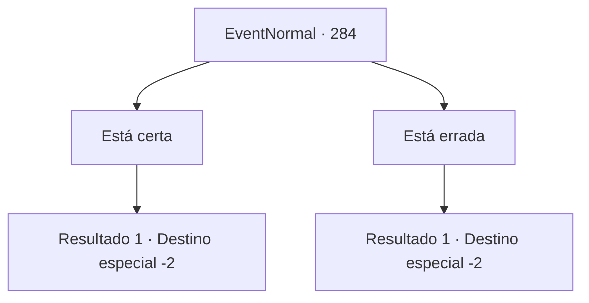

# Eventos normais · 284

[Índice da tabela](index.md) · [Índice geral](../index.md)

ID: `pt:EventNormal:284` · Fonte: `EventNormal4` · Versão: 1.2.47.

Mapeamento estático dos arquivos; a disponibilidade e a execução dependem do estado da run.

## Texto do evento

*Sem texto no arquivo.*

## Dados de entrada

```json
{
  "id": 284,
  "grade": 1,
  "place": "",
  "required": ""
}
```

## Mapa das escolhas



## Escolhas e resultados

### Escolha 1

Está certa

Requisitos e outros campos da escolha:

```json
{
  "required": ""
}
```

#### Resultado 1.1

Você diz que infelizmente, é assim que é. A velha bruxa gesticula para você abrir a carta mais uma vez. Lendo a deixa dela, você abre a carta de novo, e uma luz deslumbrante te cega. Ao abrir os olhos de novo, o desenho de um demônio preto com correntes em volta do pescoço pode ser visto na carta. 

 "O Demônio. Simboliza força de vontade quebrada e derrotismo. Uma vez que você se libertar da hipnose do demônio, quebrar as correntes que te prendem vai ser facílimo."

 Após terminar, ela silenciosamente ergue a palma da mão. Você a entrega 10 moedas de ouro e segue seu caminho.

Continuação registrada: [Destino especial `-2`](../destinos-especiais.md).

```json
{
  "required": "",
  "chance": "1",
  "nextEvent": -2,
  "type": 2,
  "reward": "0_7_1|0_6_-1|0_4_-10|5_188_1"
}
```

### Escolha 2

Está errada

Requisitos e outros campos da escolha:

```json
{
  "required": ""
}
```

#### Resultado 2.1

Você balança a cabeça, respondendo que não. Fortuna e fama estão destinadas a um dia a se encontrarem com aqueles que brilham. A velha bruxa gesticula para você abrir a carta mais uma vez. Lendo a deixa dela, você abre a carta de novo, e uma luz deslumbrante te cega. Ao abrir os olhos de novo, o desenho de uma mulher regando o solo de baixo de uma grande estrela pode ser visto na carta. 

 "A Estrela. Um raio de esperança no meio da escuridão. Parece que você é essa esperança, jovem aventureiro."

 Após terminar, ela silenciosamente ergue a palma da mão. Você a entrega 10 moedas de ouro e segue seu caminho.

Continuação registrada: [Destino especial `-2`](../destinos-especiais.md).

```json
{
  "required": "",
  "chance": "1",
  "nextEvent": -2,
  "type": 2,
  "reward": "0_12_1|0_13_-1|0_4_-10|5_188_1"
}
```

## Referências que chegam a este evento

- [Evento 283 · escolha 2 · resultado 1](0283.md#escolha-2)
