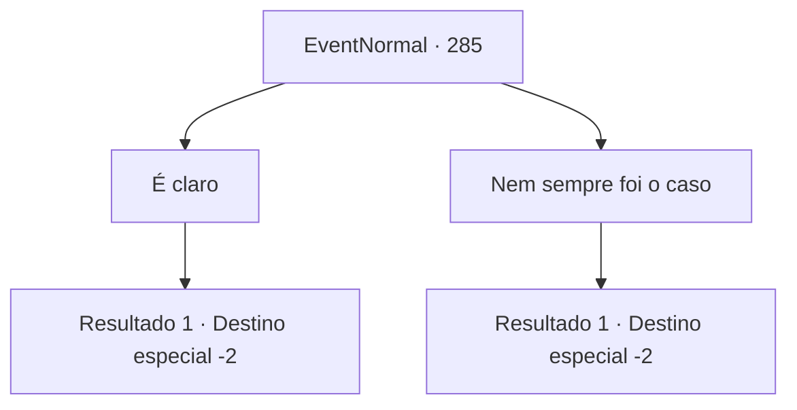

# Eventos normais · 285

[Índice da tabela](index.md) · [Índice geral](../index.md)

ID: `pt:EventNormal:285` · Fonte: `EventNormal4` · Versão: 1.2.47.

Mapeamento estático dos arquivos; a disponibilidade e a execução dependem do estado da run.

## Texto do evento

*Sem texto no arquivo.*

## Dados de entrada

```json
{
  "id": 285,
  "grade": 1,
  "place": "",
  "required": ""
}
```

## Mapa das escolhas



## Escolhas e resultados

### Escolha 1

É claro

Requisitos e outros campos da escolha:

```json
{
  "required": ""
}
```

#### Resultado 1.1

Você a diz que a história sempre foi, e sempre será, escrita pelos vitoriosos. Portanto é óbvio que que não importa o que você faça, vencer é a coisa mais importante. A velha bruxa gesticula para você abrir a carta mais uma vez. Lendo a deixa dela, você abre a carta de novo, e uma luz deslumbrante te cega. Ao abrir seus olhos de novo, um desenho de uma carruagem de guerra pode ser visto na carta. 

 "A Carruagem. Isso significa marchar rumo ao seu objetivo, não importa quem ou o que bloqueie o seu caminho. Mas, você deve ter cuidado para não perder o curso de onde você está indo."

 Após terminar, ela silenciosamente ergue a palma da mão. Você a entrega 10 moedas de ouro e segue seu caminho.

Continuação registrada: [Destino especial `-2`](../destinos-especiais.md).

```json
{
  "required": "",
  "chance": "1",
  "nextEvent": -2,
  "type": 2,
  "reward": "0_5_1|0_7_-1|0_4_-10|5_188_1"
}
```

### Escolha 2

Nem sempre foi o caso

Requisitos e outros campos da escolha:

```json
{
  "required": ""
}
```

#### Resultado 2.1

Você a diz que nem sempre é assim. A velha bruxa gesticula para você abrir a carta mais uma vez. Lendo a deixa dela, você abre a carta de novo, e uma luz deslumbrante te cega. Ao abrir os olhos de novo, o desenho de dois cães sob a lua pode ser visto na carta. 

 "A Lua. A escuridão pode impedir seu plano, então tenha cuidado,. Você terá que fazer bom uso dos poucos raios de esperança."

 Após terminar, ela silenciosamente ergue a palma da mão. Você a entrega 10 moedas de ouro e segue seu caminho.

Continuação registrada: [Destino especial `-2`](../destinos-especiais.md).

```json
{
  "required": "",
  "chance": "1",
  "nextEvent": -2,
  "type": 2,
  "reward": "0_12_1|0_7_-1|0_4_-10|5_188_1"
}
```

## Referências que chegam a este evento

- [Evento 283 · escolha 3 · resultado 1](0283.md#escolha-3)
