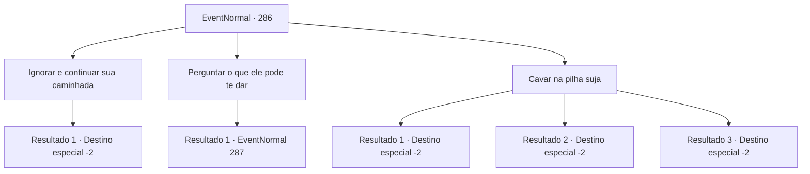

# Eventos normais · 286

[Índice da tabela](index.md) · [Índice geral](../index.md)

ID: `pt:EventNormal:286` · Fonte: `EventNormal4` · Versão: 1.2.47.

Mapeamento estático dos arquivos; a disponibilidade e a execução dependem do estado da run.

## Texto do evento

Ao viajar por um caminho de montanha, você para ao ver um bloqueio na estrada. A barricada formada de pedras e galhos quebrados faz você se perguntar se um deslizamento de terra ocorreu ou algo assim. Ao decidir se virar e procurar um caminho ao redor, você ouve a voz de um humano. 

 "Alguém aí!? Me ajude, por favor!"

 A voz fica mais clara conforme você se aproxima da pilha de sujeira.

## Dados de entrada

```json
{
  "id": 286,
  "grade": 1,
  "place": "",
  "required": "2_2_30|5_193_0"
}
```

## Mapa das escolhas



## Escolhas e resultados

### Escolha 1

Ignorar e continuar sua caminhada

Requisitos e outros campos da escolha:

```json
{
  "required": ""
}
```

#### Resultado 1.1

Você ignora a voz vindo da pilha de sujeira e vai embora. A voz pedindo por ajuda fica mais baixa, e logo fica inaudível.

Continuação registrada: [Destino especial `-2`](../destinos-especiais.md).

```json
{
  "required": "",
  "chance": "1",
  "nextEvent": -2,
  "type": 2,
  "reward": "0_3_-3|5_193_1"
}
```

### Escolha 2

Perguntar o que ele pode te dar

Requisitos e outros campos da escolha:

```json
{
  "required": ""
}
```

#### Resultado 2.1

Você pergunta à voz o que ele pode oferecer em retorno. Ele responde com uma voz rachada. 

 "Eu te darei qualquer coisa! Por favor! Ajude!!"


Continuação registrada: [Evento 287](0287.md) na mesma tabela.

```json
{
  "required": "",
  "chance": "1",
  "nextEvent": 287,
  "type": 2,
  "reward": "5_193_1"
}
```

### Escolha 3

Cavar na pilha suja

Requisitos e outros campos da escolha:

```json
{
  "required": ""
}
```

#### Resultado 3.1

Com sua pá, você desenterra a pilha de sujeira com facilidade. O homem soluçando dentro da pilha de sujeira consegue sair vivo graças a sua ajuda, e após mostrar gratidão a você, o homem lacrimejando convida você para a casa dele. Seguindo o homem até uma cabana no meio da floresta da montanha, lhe é oferecido um jantar satisfatório. No outro dia, com a despedida do homem, você continua em suas aventuras.

Continuação registrada: [Destino especial `-2`](../destinos-especiais.md).

```json
{
  "required": "8_38_1",
  "chance": "1",
  "nextEvent": -2,
  "type": 0,
  "reward": "4_38_1|0_2_1|0_3_3|5_193_1|0_0_1"
}
```

#### Resultado 3.2

Você começa a cavar com suas próprias mãos. Quanto mais você cava, mais ensanguentadas suas mãos ficam, com ferimentos aqui e ali e suas unhas quebrando, mas o pensamento de salvar uma vida te motiva. Ao quase pôr do sol, você começa a ver o rosto dele, não só a voz. O homem rapidamente escapa da pilha de sujeira com sua ajuda, e mostra gratidão à você, lacrimejando. Você o toca nas costas dua ou três vezes, e retorna à sua aventura.

Continuação registrada: [Destino especial `-2`](../destinos-especiais.md).

```json
{
  "required": "10_38_1",
  "chance": "1|0_5_1",
  "nextEvent": -2,
  "type": 0,
  "reward": "0_2_1|0_3_3|5_193_1"
}
```

#### Resultado 3.3

Você começa a cavar com suas próprias mãos. Mas aparentemente você cavou no lugar errado, porque logo a pilha de sujeira começa a desabar, junto com a voz agora gritando. Após o desabmento acabar você cava na pilha de novo, mas a única coisa que você acha é o corpo sem vida do dono da voz. Você o dá um enterro digno e deixa o local.

Continuação registrada: [Destino especial `-2`](../destinos-especiais.md).

```json
{
  "required": "10_38_1",
  "chance": "14",
  "nextEvent": -2,
  "type": 1,
  "reward": "5_193_1"
}
```

## Referências que chegam a este evento

Nenhum `nextEvent` positivo da mesma tabela aponta para este nó. Isso não prova que seja inacessível: sorteio e estado de história podem selecioná-lo.

