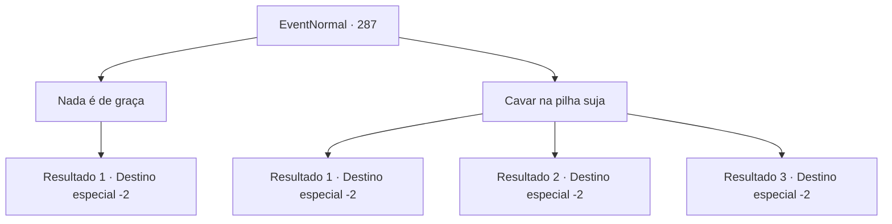

# Eventos normais · 287

[Índice da tabela](index.md) · [Índice geral](../index.md)

ID: `pt:EventNormal:287` · Fonte: `EventNormal4` · Versão: 1.2.47.

Mapeamento estático dos arquivos; a disponibilidade e a execução dependem do estado da run.

## Texto do evento

*Sem texto no arquivo.*

## Dados de entrada

```json
{
  "id": 287,
  "grade": 1,
  "place": "",
  "required": ""
}
```

## Mapa das escolhas



## Escolhas e resultados

### Escolha 1

Nada é de graça

Requisitos e outros campos da escolha:

```json
{
  "required": ""
}
```

#### Resultado 1.1

Você friamente afirma que não poderá ajudá-lo por nada. O homem na pilha de sujeira desesperadamente te promete a madeira de alta qualidade que ele mesmo cortou, mas você o ignora e vai embora.

Continuação registrada: [Destino especial `-2`](../destinos-especiais.md).

```json
{
  "required": "",
  "chance": "1",
  "nextEvent": -2,
  "type": 2,
  "reward": "0_3_-3"
}
```

### Escolha 2

Cavar na pilha suja

Requisitos e outros campos da escolha:

```json
{
  "required": ""
}
```

#### Resultado 2.1

Com sua pá, você desenterra a pilha de sujeira com facilidade. O homem soluçando dentro da pilha de sujeira consegue sair vivo graças a sua ajuda, e após mostrar gratidão a você, o homem lacrimejando convida você para a casa dele. Seguindo o homem até uma cabana no meio da floresta da montanha, lhe é oferecido um jantar satisfatório. Você também tem um descanso confortável, que você não tinha há um bom tempo. No outro dia, com a despedida do homem, você continua em suas aventuras.

Continuação registrada: [Destino especial `-2`](../destinos-especiais.md).

```json
{
  "required": "8_38_1",
  "chance": "1",
  "nextEvent": -2,
  "type": 0,
  "reward": "4_38_1|0_2_1|0_3_3|0_0_1"
}
```

#### Resultado 2.2

Você começa a cavar com suas próprias mãos. Quanto mais você cava, mais ensanguentadas suas mãos ficam, com ferimentos aqui e ali e suas unhas quebrando, mas o pensamento de salvar uma vida te motiva. Ao quase pôr do sol, você começa a ver o rosto dele, não só a voz. O homem soluçando dentro da pilha de sujeira consegue sair vivo graças a sua ajuda, e após te mostrar gratidão, ele te convida para a casa dele. Seguindo o homem até uma cabana no meio da floresta da montanha, lhe é oferecido um jantar satisfatório. Você também tem um descanso confortável, que você não tinha há um bom tempo.

Continuação registrada: [Destino especial `-2`](../destinos-especiais.md).

```json
{
  "required": "10_38_1",
  "chance": "1|0_5_1",
  "nextEvent": -2,
  "type": 0,
  "reward": "0_2_1|0_3_3|0_0_1"
}
```

#### Resultado 2.3

Você começa a cavar com suas próprias mãos. Mas aparentemente você cavou no lugar errado, porque logo a pilha de sujeira começa a desabar, junto com a voz agora gritando. Após o desabmento acabar você cava na pilha de novo, mas a única coisa que você acha é o corpo sem vida do dono da voz. Você o dá um enterro digno e deixa o local.

Continuação registrada: [Destino especial `-2`](../destinos-especiais.md).

```json
{
  "required": "10_38_1",
  "chance": "14",
  "nextEvent": -2,
  "type": 1,
  "reward": ""
}
```

## Referências que chegam a este evento

- [Evento 286 · escolha 2 · resultado 1](0286.md#escolha-2)
