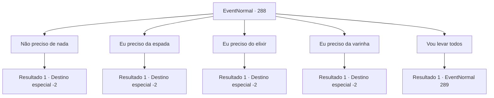

# Eventos normais · 288

[Índice da tabela](index.md) · [Índice geral](../index.md)

ID: `pt:EventNormal:288` · Fonte: `EventNormal4` · Versão: 1.2.47.

Mapeamento estático dos arquivos; a disponibilidade e a execução dependem do estado da run.

## Texto do evento

Você encontra outro aventureiro carregando uma mochila enorme. Quando ele te ver, ele se aproxima com um sorriso caloroso. 

 "Ei. Precisa de algo? Que tal trocarmos por coisas de que precisamos?"

 Ele larga a mochila enorme e guarda seus itens. Suas mercadorias incluem uma espada armada de metal, um elixir do gladiador e uma varinha de vidro. A julgar pela qualidade de seus produtos, ele cuida bem deles. 

 "Uma poção de saúde para a espada, um orbe de serpe para o elixir e um escudo de escama de felino do mar para a varinha de vidro. Interessado?"


## Dados de entrada

```json
{
  "id": 288,
  "grade": 1,
  "place": "",
  "required": "5_189_0"
}
```

## Mapa das escolhas



## Escolhas e resultados

### Escolha 1

Não preciso de nada

Requisitos e outros campos da escolha:

```json
{
  "required": ""
}
```

#### Resultado 1.1

Você não faz troca e segue em frente.

Continuação registrada: [Destino especial `-2`](../destinos-especiais.md).

```json
{
  "required": "",
  "chance": "1",
  "nextEvent": -2,
  "type": 2,
  "reward": "5_189_1"
}
```

### Escolha 2

Eu preciso da espada

Requisitos e outros campos da escolha:

```json
{
  "required": "8_36_1"
}
```

#### Resultado 2.1

Ele te entrega a espada armada de liga. 

 "A lâmina de liga a faz uma espada resistente. Boa escolha, eu digo!"

 Você a pega e entrega uma poção de saúde a ele. Ele põe um sorriso satisfatório. 

 "Eu acredito que isso é meu, então. Bom fazer negócios!"

 O aventureiro parte com uma risada calorosa.

Continuação registrada: [Destino especial `-2`](../destinos-especiais.md).

```json
{
  "required": "",
  "chance": "1",
  "nextEvent": -2,
  "type": 2,
  "reward": "4_36_1|3_74_1|5_189_1"
}
```

### Escolha 3

Eu preciso do elixir

Requisitos e outros campos da escolha:

```json
{
  "required": "8_45_1"
}
```

#### Resultado 3.1

Ele te entrega o elixir do gladiador. 

 "Deixa seu corpo bem musculoso quando você bebe. Boa escolha, eu digo!"

 Você a pega e entrega uma orbe de serpe a ele. Ele põe um sorriso satisfatório. 

 "Eu acredito que isso é meu, então. Bom fazer negócios!"

 O aventureiro parte com uma risada calorosa.

Continuação registrada: [Destino especial `-2`](../destinos-especiais.md).

```json
{
  "required": "",
  "chance": "1",
  "nextEvent": -2,
  "type": 2,
  "reward": "4_45_1|3_99_1|5_189_1"
}
```

### Escolha 4

Eu preciso da varinha

Requisitos e outros campos da escolha:

```json
{
  "required": "8_118_1"
}
```

#### Resultado 4.1

Ele te entrega a varinha de vidro. 

 "Uma verdadeira beleza manufaturada em vidro. Boa escolha, eu digo!"

 Você a pega e entrega uma escama de gato do mar a ele. Ele põe um sorriso satisfatório. 

 "Eu acredito que isso é meu, então. Bom fazer negócios!"

 O aventureiro parte com uma risada calorosa.

Continuação registrada: [Destino especial `-2`](../destinos-especiais.md).

```json
{
  "required": "",
  "chance": "1",
  "nextEvent": -2,
  "type": 2,
  "reward": "4_118_1|3_89_1|5_189_1"
}
```

### Escolha 5

Vou levar todos

Requisitos e outros campos da escolha:

```json
{
  "required": "2_3_-15"
}
```

#### Resultado 5.1

Você aponta sua arma para o aventureiro e as mercadorias dele. Ele saca a espada dele, resmugando para si mesmo. 

 "Uh... você está deixando isso complicado."


Continuação registrada: [Evento 289](0289.md) na mesma tabela.

```json
{
  "required": "",
  "chance": "1",
  "nextEvent": 289,
  "type": 2,
  "reward": "6_0_62|5_189_1|0_3_-3",
  "place": 0
}
```

## Referências que chegam a este evento

Nenhum `nextEvent` positivo da mesma tabela aponta para este nó. Isso não prova que seja inacessível: sorteio e estado de história podem selecioná-lo.

