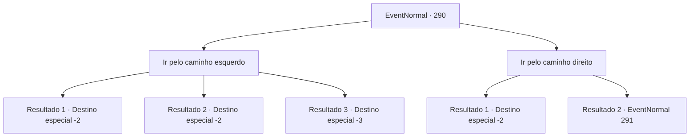

# Eventos normais · 290

[Índice da tabela](index.md) · [Índice geral](../index.md)

ID: `pt:EventNormal:290` · Fonte: `EventNormal4` · Versão: 1.2.47.

Mapeamento estático dos arquivos; a disponibilidade e a execução dependem do estado da run.

## Texto do evento

Você se depara com um caminho dividido. De acordo com a placa no meio, o caminho da esquerda é um atalho para uma vila próxima, enquanto o caminho direito leva à mesma aldeia, com um caminho longo, mas confortável.

## Dados de entrada

```json
{
  "id": 290,
  "grade": 1,
  "place": "",
  "required": ""
}
```

## Mapa das escolhas



## Escolhas e resultados

### Escolha 1

Ir pelo caminho esquerdo

Requisitos e outros campos da escolha:

```json
{
  "required": ""
}
```

#### Resultado 1.1

Você decide ir pelo atalho perigoso. Você passa por situações perigosas como ser furado por arbustos espinhosos e quase cair de um penhasco, mas você consegue chegar no vilarejo.

Continuação registrada: [Destino especial `-2`](../destinos-especiais.md).

```json
{
  "required": "",
  "chance": "1|0_6_1",
  "nextEvent": -2,
  "type": 0,
  "reward": "0_2_1"
}
```

#### Resultado 1.2

Você decide ir pelo atalho perigoso. O caminho é bem mais cruel que você achou que seria, e só após ser furado por arbustos espinhosos e tropeçar em pedras, você chega ao vilarejo próximo com feridas em todo o corpo.

Continuação registrada: [Destino especial `-2`](../destinos-especiais.md).

```json
{
  "required": "1_0_2",
  "chance": "12",
  "nextEvent": -2,
  "type": 1,
  "reward": "0_0_-1"
}
```

#### Resultado 1.3

Você decide ir pelo atalho perigoso. Mas o caminho é bem mais cruel que você achou que seria, e você tropeça e cai de um penhasco para sua perdição.

Continuação registrada: [Destino especial `-3`](../destinos-especiais.md).

```json
{
  "required": "2_0_2",
  "chance": "12",
  "nextEvent": -3,
  "type": 1,
  "reward": "0_0_-1"
}
```

### Escolha 2

Ir pelo caminho direito

Requisitos e outros campos da escolha:

```json
{
  "required": ""
}
```

#### Resultado 2.1

Você decide ir pelo caminho lento porém confortável da direita. Nada te importuna pelo caminho, e nem você obtém nada novo.

Continuação registrada: [Destino especial `-2`](../destinos-especiais.md).

```json
{
  "required": "",
  "chance": "1",
  "nextEvent": -2,
  "type": 2,
  "reward": ""
}
```

#### Resultado 2.2

Você decide ir pelo caminho lento porém confortável da direita. Mas logo depois, você cruza com um obstáculo. Um urso pardo selvagem te avista e avança em você com olhos penetrantes.

Continuação registrada: [Evento 291](0291.md) na mesma tabela.

```json
{
  "required": "",
  "chance": "3",
  "nextEvent": 291,
  "type": 2,
  "reward": ""
}
```

## Referências que chegam a este evento

Nenhum `nextEvent` positivo da mesma tabela aponta para este nó. Isso não prova que seja inacessível: sorteio e estado de história podem selecioná-lo.

