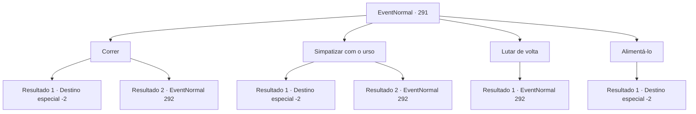

# Eventos normais · 291

[Índice da tabela](index.md) · [Índice geral](../index.md)

ID: `pt:EventNormal:291` · Fonte: `EventNormal4` · Versão: 1.2.47.

Mapeamento estático dos arquivos; a disponibilidade e a execução dependem do estado da run.

## Texto do evento

*Sem texto no arquivo.*

## Dados de entrada

```json
{
  "id": 291,
  "grade": 1,
  "place": "",
  "required": ""
}
```

## Mapa das escolhas



## Escolhas e resultados

### Escolha 1

Correr

Requisitos e outros campos da escolha:

```json
{
  "required": ""
}
```

#### Resultado 1.1

Você começa a recuar lentamente, então vira as costas para correr com toda sua energia. O urso te persegue furiosamente, mas falha em te acompanhar.

Continuação registrada: [Destino especial `-2`](../destinos-especiais.md).

```json
{
  "required": "",
  "chance": "1|0_6_1",
  "nextEvent": -2,
  "type": 0,
  "reward": ""
}
```

#### Resultado 1.2

Você começa a recuar lentamente, então vira as costas para correr com toda sua energia. O urso te persegue furiosamente, e com sucesso morde sua mochila. Você não tem escolha a não ser lutar.

Continuação registrada: [Evento 292](0292.md) na mesma tabela.

```json
{
  "required": "",
  "chance": "13",
  "nextEvent": 292,
  "type": 1,
  "reward": "6_3_77",
  "place": 1
}
```

### Escolha 2

Simpatizar com o urso

Requisitos e outros campos da escolha:

```json
{
  "required": ""
}
```

#### Resultado 2.1

Você lentamente se aproxima do urso pardo, o olhando nos olhos. Então você lentamente o afaga na cabeça. O urso balança a cabeça alegremente e então vai embora. Após o urso ter ido embora, você anda por mais alguns minutos e chega a um pequeno vilarejo. Você descansa brevemente lá, e continua com sua aventura.

Continuação registrada: [Destino especial `-2`](../destinos-especiais.md).

```json
{
  "required": "",
  "chance": "1|0_12_1",
  "nextEvent": -2,
  "type": 0,
  "reward": ""
}
```

#### Resultado 2.2

Você lentamente se aproxima do urso pardo, o olhando nos olhos. O urso avança em você furiosamente.

Continuação registrada: [Evento 292](0292.md) na mesma tabela.

```json
{
  "required": "",
  "chance": "15",
  "nextEvent": 292,
  "type": 1,
  "reward": "6_3_77",
  "place": 1
}
```

### Escolha 3

Lutar de volta

Requisitos e outros campos da escolha:

```json
{
  "required": ""
}
```

#### Resultado 3.1

Você decide remover o urso bloqueando o caminho com sua força.

Continuação registrada: [Evento 292](0292.md) na mesma tabela.

```json
{
  "required": "",
  "chance": "1",
  "nextEvent": 292,
  "type": 2,
  "reward": "6_0_77",
  "place": 1
}
```

### Escolha 4

Alimentá-lo

Requisitos e outros campos da escolha:

```json
{
  "required": "23_0_1"
}
```

#### Resultado 4.1

Você joga algo para o urso comer, e se esgueira enquanto o urso está comendo. Após andar por mais alguns minutos, um pequeno vilarejo se revela. Você descansa brevemente lá, e continua com sua aventura.

Continuação registrada: [Destino especial `-2`](../destinos-especiais.md).

```json
{
  "required": "",
  "chance": "1",
  "nextEvent": -2,
  "type": 2,
  "reward": "25_0_1"
}
```

## Referências que chegam a este evento

- [Evento 290 · escolha 2 · resultado 2](0290.md#escolha-2)
