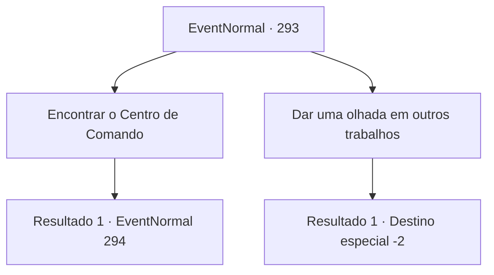

# Eventos normais · 293

[Índice da tabela](index.md) · [Índice geral](../index.md)

ID: `pt:EventNormal:293` · Fonte: `EventNormal4` · Versão: 1.2.47.

Mapeamento estático dos arquivos; a disponibilidade e a execução dependem do estado da run.

## Texto do evento

Você chega em 'Glitz', uma cidade em conflito com um grupo de orcs. A atmosfera da cidade parece áspera e perigosa, pelas múltiplas batalhas que ocorreram antes. Você examina cuidadosamente a cidade à procura de empregos. Você encontra algo interessante entre os muitos pedidos no quadro de avisos. 

 "Procura-se aventureiros para ajudar na negociação com os orcs. Venha nos encontrar no Centro de Comando."

 A julgar pela umidade da tinta, este pedido parece bem novo.

## Dados de entrada

```json
{
  "id": 293,
  "grade": 1,
  "place": "",
  "required": "5_190_0"
}
```

## Mapa das escolhas



## Escolhas e resultados

### Escolha 1

Encontrar o Centro de Comando

Requisitos e outros campos da escolha:

```json
{
  "required": ""
}
```

#### Resultado 1.1

Você visita o Centro de Comando. O Centro de Comando, construído perto das fortificações que protegem a cidade, está cheio de soldados de aparência severa, cumprindo suas funções diligentemente. Quando você mostra a solicitação do quadro de avisos aos soldados, eles te guiam à sala de audiência. Logo depois, um homem com um bigode magnífico entra na sala. Ele se apresenta como o Lorde de Glitz, 'Lord Adela', e te informa sobre o status quo. 

 "A situação aqui em nossa cidade não está tão boa. Com a ajuda de tropas de outras cidades, aqueles malditos orcs serão exterminados rapidamente, mas eles estão se recusando a intervir, dizendo que o conflito não é problema deles."

 Adela curva os lábios, obviamente não gostando da situação. 

 "De qualquer forma, nós conseguimos garantir uma mesa de negociação... mas ainda estamos num impasse, falhando em concordar em termos. Nossa esperança é que você, aventureiro, possa por fim nesse impasse."

 Adela adiciona que se essa situação continuar, haverá outra batalha.

Continuação registrada: [Evento 294](0294.md) na mesma tabela.

```json
{
  "required": "",
  "chance": "1",
  "nextEvent": 294,
  "type": 2,
  "reward": "5_190_1"
}
```

### Escolha 2

Dar uma olhada em outros trabalhos

Requisitos e outros campos da escolha:

```json
{
  "required": ""
}
```

#### Resultado 2.1

Sem o talento de arranjar uma negociação, você dá uma olhada nas outras solicitações. Mas falha em achar qualquer coisa intrigante.

Continuação registrada: [Destino especial `-2`](../destinos-especiais.md).

```json
{
  "required": "",
  "chance": "1",
  "nextEvent": -2,
  "type": 2,
  "reward": "5_190_9"
}
```

## Referências que chegam a este evento

Nenhum `nextEvent` positivo da mesma tabela aponta para este nó. Isso não prova que seja inacessível: sorteio e estado de história podem selecioná-lo.

