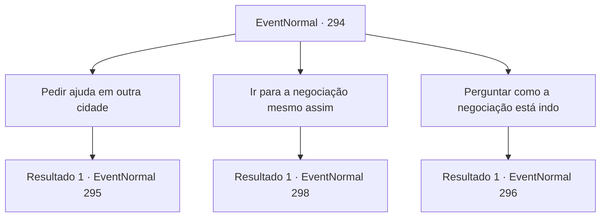

# Eventos normais · 294

[Índice da tabela](index.md) · [Índice geral](../index.md)

ID: `pt:EventNormal:294` · Fonte: `EventNormal4` · Versão: 1.2.47.

Mapeamento estático dos arquivos; a disponibilidade e a execução dependem do estado da run.

## Texto do evento

*Sem texto no arquivo.*

## Dados de entrada

```json
{
  "id": 294,
  "grade": 1,
  "place": "",
  "required": ""
}
```

## Mapa das escolhas



## Escolhas e resultados

### Escolha 1

Pedir ajuda em outra cidade

Requisitos e outros campos da escolha:

```json
{
  "required": ""
}
```

#### Resultado 1.1

Você decide visitar uma cidade próxima e pedir ajuda. Adela te empresta um cavalo, te desejando boa sorte. 

 Por dois dias você cavalga, e finalmente chega à cidade mais próxima, 'Esiz'. A atmosfera pacífica é completamente diferente daquela em Glitz, e a cidade não podia se preocupar menos com orcs. Você encontra o lorde de Esiz e explica a situação em Glitz, implorando por assistência, mas a única resposta que você recebe é que Esiz não irá interferir em problemas de outra cidade.

Continuação registrada: [Evento 295](0295.md) na mesma tabela.

```json
{
  "required": "",
  "chance": "1",
  "nextEvent": 295,
  "type": 2,
  "reward": ""
}
```

### Escolha 2

Ir para a negociação mesmo assim

Requisitos e outros campos da escolha:

```json
{
  "required": ""
}
```

#### Resultado 2.1

Você decide resolver isso de uma vez por todas com os orcs, com zero hesitação. Os orcs levantaram acampamento, bem em frente à cidade, os soldados orcs saem de suas tendas cor de cinza, cautelosos, gritando com você na língua deles. Você tenta os dizer que você está aqui a respeito da negociação, mas nenhum dos orcs parece entender língua humana.

Continuação registrada: [Evento 298](0298.md) na mesma tabela.

```json
{
  "required": "",
  "chance": "1",
  "nextEvent": 298,
  "type": 2,
  "reward": ""
}
```

### Escolha 3

Perguntar como a negociação está indo

Requisitos e outros campos da escolha:

```json
{
  "required": ""
}
```

#### Resultado 3.1

Você decide primeiro verificar como está indo a negociação. Adela ordena a um de seus servos para chamar o intérprete, dizendo-lhe para perguntar qualquer coisa que você deseje saber. 

 "Este homem é nosso intérprete para a língua orc. Ele está ciente dos detalhes das negociações."


Continuação registrada: [Evento 296](0296.md) na mesma tabela.

```json
{
  "required": "",
  "chance": "1",
  "nextEvent": 296,
  "type": 2,
  "reward": ""
}
```

## Referências que chegam a este evento

- [Evento 293 · escolha 1 · resultado 1](0293.md#escolha-1)
