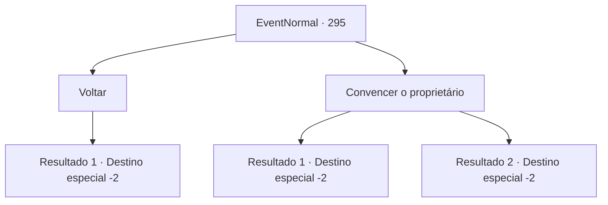

# Eventos normais · 295

[Índice da tabela](index.md) · [Índice geral](../index.md)

ID: `pt:EventNormal:295` · Fonte: `EventNormal4` · Versão: 1.2.47.

Mapeamento estático dos arquivos; a disponibilidade e a execução dependem do estado da run.

## Texto do evento

*Sem texto no arquivo.*

## Dados de entrada

```json
{
  "id": 295,
  "grade": 1,
  "place": "",
  "required": ""
}
```

## Mapa das escolhas



## Escolhas e resultados

### Escolha 1

Voltar

Requisitos e outros campos da escolha:

```json
{
  "required": ""
}
```

#### Resultado 1.1

Infelizmente, você monta o cavalo de volta para Glitz e diz que o pedido de ajuda não foi atendido. Adela vira as costas, aparentemente não esperando nada desde o início. Ele então começa a se preparar para a batalha, dizendo que não há mais tempo a perder com negociações. Você deixa Glitz, deixando para trás os sons de armas e armaduras se chocando, juntamente com os rugidos dos soldados.

Continuação registrada: [Destino especial `-2`](../destinos-especiais.md).

```json
{
  "required": "",
  "chance": "1",
  "nextEvent": -2,
  "type": 2,
  "reward": "5_190_9"
}
```

### Escolha 2

Convencer o proprietário

Requisitos e outros campos da escolha:

```json
{
  "required": ""
}
```

#### Resultado 2.1

Você implora mais uma vez ao Senhor de Esiz por assistência. Por fim, após uma consideração cuidadosa, ele decide enviar algumas tropas de seu exército particular. Alguns dias depois, você volta a brilhar com um exército de soldados totalmente preparados, diretamente de Esiz. Adela parece feliz com os soldados que você trouxe e logo chama seus cavaleiros para o centro de comando, planejando a estratégia para derrotar os orcs. 

 Mais dois dias se passam, e a batalha furiosa termina com a derrota da Força Orcish, os soldados de Esiz e brilham usando um ao outro como desvio. Quanto à sua recompensa, você recebe uma armadura completa, o símbolo dos cavaleiros.

Continuação registrada: [Destino especial `-2`](../destinos-especiais.md).

```json
{
  "required": "",
  "chance": "1|0_7_1",
  "nextEvent": -2,
  "type": 0,
  "reward": "0_2_1|3_33_1|5_190_9"
}
```

#### Resultado 2.2

Você implora mais uma vez ao senhor de Esiz por ajuda. Mas ele não muda sua opinião. Infelizmente, você monta o cavalo de volta para Glitz e diz que o pedido de ajuda não foi respondido. Adela vira as costas, aparentemente não esperando nada desde o início. Ele então começa a se preparar para a guerra, dizendo que não há mais tempo a perder com negociações. Você deixa Glitz silenciosamente, durante a calma antes da tempestade.

Continuação registrada: [Destino especial `-2`](../destinos-especiais.md).

```json
{
  "required": "",
  "chance": "14",
  "nextEvent": -2,
  "type": 1,
  "reward": "5_190_9"
}
```

## Referências que chegam a este evento

- [Evento 294 · escolha 1 · resultado 1](0294.md#escolha-1)
- [Evento 296 · escolha 4 · resultado 1](0296.md#escolha-4)
