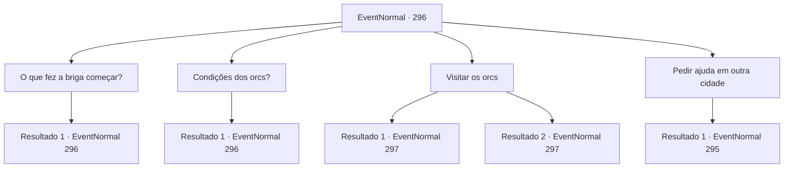

# Eventos normais · 296

[Índice da tabela](index.md) · [Índice geral](../index.md)

ID: `pt:EventNormal:296` · Fonte: `EventNormal4` · Versão: 1.2.47.

Mapeamento estático dos arquivos; a disponibilidade e a execução dependem do estado da run.

## Texto do evento

*Sem texto no arquivo.*

## Dados de entrada

```json
{
  "id": 296,
  "grade": 1,
  "place": "",
  "required": ""
}
```

## Mapa das escolhas



## Escolhas e resultados

### Escolha 1

O que fez a briga começar?

Requisitos e outros campos da escolha:

```json
{
  "required": "5_194_0"
}
```

#### Resultado 1.1

Você pergunta ao intérprete como o conflito com os orcs começou em primeiro lugar. Adela solta um suspiro profundo e fala. 

 "Ah, eu posso responder isso. A terra que eu controlo ainda tem muitas montanhas não desenvolvidas. Então eu ordenei que meu povo fizesse uma queimada, para a agricultura. Mas essa montanha é exatamente onde esses orcs viviam... Foi lá que ocorreu o confronto e é a razão pela qual eles estão à nossa porta agora."


Continuação registrada: [Evento 296](0296.md) na mesma tabela.

```json
{
  "required": "",
  "chance": "1",
  "nextEvent": 296,
  "type": 2,
  "reward": "5_194_1"
}
```

### Escolha 2

Condições dos orcs?

Requisitos e outros campos da escolha:

```json
{
  "required": "5_194_1"
}
```

#### Resultado 2.1

Você pergunta ao intérprete sobre os termos para negociação dos orcs. Depois de pensar por muito tempo, o intérprete responde, gaguejando. 

 "Os orcs exigiram que uma parte da cidade fosse reconhecida como seu território, juntamente com rações de comida suficientes para alimentar 500 deles por seis meses e 300... não, 600 armas."

 Adela, ouvindo o intérprete, grita furiosamente. 

 "Inaceitável! Seria compreensível se eles pedissem a montanha para ser deles... se eles realmente querem tanta comida e armas, eles terão que vir e pegar."


Continuação registrada: [Evento 296](0296.md) na mesma tabela.

```json
{
  "required": "",
  "chance": "1",
  "nextEvent": 296,
  "type": 2,
  "reward": "5_194_2"
}
```

### Escolha 3

Visitar os orcs

Requisitos e outros campos da escolha:

```json
{
  "required": "5_194_2"
}
```

#### Resultado 3.1

Após ouvir sobre o processo de negociação, você decide visitar os orcs, junto com o intérprete. Eles montaram acampamentos bem na frente da cidade, e soldados orcs saem de suas tendas de cor cinza, desconfiados, gritando com você em sua língua. Você ordena ao intérprete para dizer aos orcs que você está aqui para negociação. Mas depois de ouvir o intérprete, os orcs ficam irritados em vez disso, e começam a ameaçar você, prontos para atacar a qualquer momento.

Continuação registrada: [Evento 297](0297.md) na mesma tabela.

```json
{
  "required": "2_7_15",
  "chance": "1",
  "nextEvent": 297,
  "type": 2,
  "reward": ""
}
```

#### Resultado 3.2

Após ouvir sobre o processo de negociação, você decide visitar os orcs, junto com o intérprete. Eles montaram acampamentos bem na frente da cidade, e soldados orcs saem de suas tendas cinza-fuligem, cautelosos, gritando com você em sua língua. Você ordena ao intérprete para dizer aos orcs que você está aqui para negociar. Mas depois de ouvir o intérprete, os orcs ficam irritados em vez disso, e começam a ameaçá-lo, prontos para atacar a qualquer momento. Você percebe que o 'orcês' que o intérprete está falando é tudo bobagem.

Continuação registrada: [Evento 297](0297.md) na mesma tabela.

```json
{
  "required": "1_7_15",
  "chance": "1",
  "nextEvent": 297,
  "type": 2,
  "reward": "5_194_3"
}
```

### Escolha 4

Pedir ajuda em outra cidade

Requisitos e outros campos da escolha:

```json
{
  "required": ""
}
```

#### Resultado 4.1

Você decide visitar uma cidade próxima e pedir ajuda. Adela lhe empresta um cavalo, desejando boa sorte. 

 Por dois dias, você cavalga e finalmente chega à cidade mais próxima, 'Esiz'. A atmosfera pacífica é completamente diferente da de Glitz, e a cidade não podia se preocupar menos com orcs. Você conhece o Senhor de Esiz e explica a situação em brilho, pedindo assistência, Mas a única resposta que você obtém é que o Esiz não interferirá nos problemas de outra cidade.

Continuação registrada: [Evento 295](0295.md) na mesma tabela.

```json
{
  "required": "",
  "chance": "1",
  "nextEvent": 295,
  "type": 2,
  "reward": ""
}
```

## Referências que chegam a este evento

- [Evento 294 · escolha 3 · resultado 1](0294.md#escolha-3)
- [Evento 296 · escolha 1 · resultado 1](0296.md#escolha-1)
- [Evento 296 · escolha 2 · resultado 1](0296.md#escolha-2)
