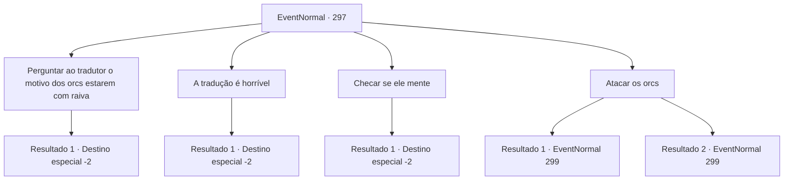

# Eventos normais · 297

[Índice da tabela](index.md) · [Índice geral](../index.md)

ID: `pt:EventNormal:297` · Fonte: `EventNormal4` · Versão: 1.2.47.

Mapeamento estático dos arquivos; a disponibilidade e a execução dependem do estado da run.

## Texto do evento

*Sem texto no arquivo.*

## Dados de entrada

```json
{
  "id": 297,
  "grade": 1,
  "place": "",
  "required": ""
}
```

## Mapa das escolhas



## Escolhas e resultados

### Escolha 1

Perguntar ao tradutor o motivo dos orcs estarem com raiva

Requisitos e outros campos da escolha:

```json
{
  "required": "18_194_3"
}
```

#### Resultado 1.1

Você pergunta ao intérprete por que os orcs estão tão irritados. Mas ele apenas balança as mãos, suando profusamente, e gagueja que ele também não sabe por que os orcs estão agindo assim. Não vendo uma opção melhor, você retorna à cidade com o intérprete. Assim que as portas do castelo se abrem e você entra, Adela corre até você, esperando notícias, mas a única mensagem que você pode entregar é que a negociação falhou. Adela retorna ao Centro de Comando, muito desapontada, e você sai silenciosamente da cidade que em breve será um campo de batalha.

Continuação registrada: [Destino especial `-2`](../destinos-especiais.md).

```json
{
  "required": "",
  "chance": "1",
  "nextEvent": -2,
  "type": 2,
  "reward": "5_190_9"
}
```

### Escolha 2

A tradução é horrível

Requisitos e outros campos da escolha:

```json
{
  "required": "5_194_3"
}
```

#### Resultado 2.1

O intérprete ouve seu comentário, se ajoelha e implora. 

 "Me desculpe muito! Tudo sobre falar a língua dos orcs, é tudo mentira! Eu tentei te contar, mas eu..."

 Ele conta sua história, chorando. De acordo com ele, o chamado intérprete costumava ser um comerciante. Enquanto ele estava bebendo com seus amigos, ele ficou convencido e contou aos seus amigos que estava envolvido em um comércio com os orcs. Essa informação chegou ao Senhor Adela, que designou aquele comerciante como intérprete para a negociação. Ele acrescenta que não houve oportunidade de contar a verdade a ninguém, então ele tem falado qualquer coisa que lhe vem à mente. Então você decide liderar a negociação, em vez do falso intérprete. Você cumprimenta os orcs de forma desajeitada em sua língua, o que parece tê-los surpreendido. Logo, um orc maior, aparentemente o comandante, se aproxima de você e fala. 

 "Você está ciente de que os humanos incendiaram nossa montanha? Nossas condições são simples. Não temos motivo para invadir sua cidade, desde que você respeite nossa terra e não ultrapasse nosso território."

 Você diz aos orcs que houve um pequeno mal-entendido e volta para Adela para entregar as demandas dos orcs. Depois de ouvir o que você disse, Adela responde felizmente. 

 "Eu estava preocupado com o que fazer a seguir. Estou feliz. E quanto ao intérprete... Acho que vou mandá-lo para a prisão. Você foi de grande ajuda."

 Ele mostra sua gratidão e recompensa você com uma armadura dada apenas aos cavaleiros.

Continuação registrada: [Destino especial `-2`](../destinos-especiais.md).

```json
{
  "required": "",
  "chance": "1",
  "nextEvent": -2,
  "type": 2,
  "reward": "0_2_1|3_33_1|5_190_9"
}
```

### Escolha 3

Checar se ele mente

Requisitos e outros campos da escolha:

```json
{
  "required": "8_93_1"
}
```

#### Resultado 3.1

Para ter certeza de que ele estava mentindo, você pegou 'O Respondedor' e o empurrou em seu pescoço. Ele se ajoelhou na sua frente e implorou. 

 "Me desculpe muito! Tudo sobre falar a língua dos orcs, é tudo mentira! Eu tentei te contar, mas eu..."

 Ele conta sua história, chorando. De acordo com ele, o chamado intérprete costumava ser um comerciante. Enquanto ele estava bebendo com seus amigos, ele ficou convencido e contou aos seus amigos que estava envolvido em um comércio com os orcs. Essa informação chegou ao Lorde Adela, que designou aquele comerciante como intérprete para a negociação. Ele acrescenta que não houve oportunidade de contar a verdade a ninguém, então ele tem falado qualquer coisa que lhe vem à mente. Então você decide liderar a negociação, em vez do falso intérprete. Você cumprimenta os orcs de forma desajeitada em sua língua, o que parece tê-los surpreendido. Logo, um orc maior, aparentemente o comandante, se aproxima de você e fala. 

 "Você está ciente de que os humanos incendiaram nossa montanha? Nossas condições são simples. Não temos motivo para invadir sua cidade, desde que você respeite nossa terra e não ultrapasse nosso território."

 Você diz aos orcs que houve um pequeno mal-entendido e volta para Adela para entregar as demandas dos orcs. Após ouvir o que você disse, Adela responde felizmente. 

 "Eu estava preocupado com o que fazer a seguir. Estou feliz. E quanto ao intérprete... Acho que vou tê-lo trancado. Você foi de grande ajuda."

 Ele mostra sua gratidão e recompensa você com uma armadura dada apenas aos cavaleiros.

Continuação registrada: [Destino especial `-2`](../destinos-especiais.md).

```json
{
  "required": "",
  "chance": "1",
  "nextEvent": -2,
  "type": 2,
  "reward": "0_2_1|3_33_1|5_190_9"
}
```

### Escolha 4

Atacar os orcs

Requisitos e outros campos da escolha:

```json
{
  "required": ""
}
```

#### Resultado 4.1

Você rapidamente se aproxima do orc guardando a barraca, pega-o de surpresa e corta sua garganta. O espirro do sangue enfurece os orcs próximos, enquanto eles avançam até você furiosamente.

Continuação registrada: [Evento 299](0299.md) na mesma tabela.

```json
{
  "required": "",
  "chance": "1|0_6_1",
  "nextEvent": 299,
  "type": 0,
  "reward": "6_0_104",
  "place": 0
}
```

#### Resultado 4.2

Você rapidamente se aproxima do orc guardando a barraca, pega-o de surpresa e corta sua garganta. O espirro do sangue enfurece os orcs próximos, enquanto eles avançam até você furiosamente.

Continuação registrada: [Evento 299](0299.md) na mesma tabela.

```json
{
  "required": "",
  "chance": "14",
  "nextEvent": 299,
  "type": 1,
  "reward": "6_3_104",
  "place": 0
}
```

## Referências que chegam a este evento

- [Evento 296 · escolha 3 · resultado 1](0296.md#escolha-3)
- [Evento 296 · escolha 3 · resultado 2](0296.md#escolha-3)
