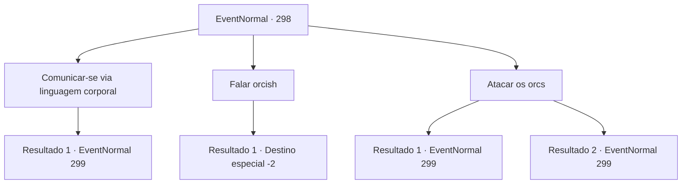

# Eventos normais · 298

[Índice da tabela](index.md) · [Índice geral](../index.md)

ID: `pt:EventNormal:298` · Fonte: `EventNormal4` · Versão: 1.2.47.

Mapeamento estático dos arquivos; a disponibilidade e a execução dependem do estado da run.

## Texto do evento

*Sem texto no arquivo.*

## Dados de entrada

```json
{
  "id": 298,
  "grade": 1,
  "place": "",
  "required": ""
}
```

## Mapa das escolhas



## Escolhas e resultados

### Escolha 1

Comunicar-se via linguagem corporal

Requisitos e outros campos da escolha:

```json
{
  "required": ""
}
```

#### Resultado 1.1

Tentas comunicar-te com os orcs, usando as tuas mãos e pés. Mas apesar dos teus melhores esforços, os orcs não te entendem. Talvez tenham interpretado como um ato de hostilidade, já que estão a correr na tua direção com as suas armas em punho.

Continuação registrada: [Evento 299](0299.md) na mesma tabela.

```json
{
  "required": "",
  "chance": "1",
  "nextEvent": 299,
  "type": 2,
  "reward": "6_0_104",
  "place": 0
}
```

### Escolha 2

Falar orcish

Requisitos e outros campos da escolha:

```json
{
  "required": "1_7_15"
}
```

#### Resultado 2.1

Você se lembra do idioma orcish que ouviu em algum lugar no passado e fala com eles. Eles parecem um pouco surpresos ao ouvir Orcish de um humano como você. Logo, um orc maior, aparentemente o comandante, se aproxima de você e fala. 

 "Você está ciente do fato de que os humanos incendiaram em nossa montanha? Nossas condições são simples. Não temos motivos para invadir sua cidade, desde que você respeite nossa terra e não invade nosso território."

 Você diz aos Orcs que houve um leve mal -entendido e retorna a Adela para oferecer a ele as demandas dos Orcs. Depois de ouvir o que você disse, Adela responde alegremente, embora com um rosto perplexo. 

 "Isso é completamente diferente do que o intérprete me disse ... mas obrigado de qualquer maneira. Tudo terminou bem graças a você, então acho que uma recompensa está em ordem."

 Ele mostra sua gratidão e o recompensa com uma armadura dada apenas aos cavaleiros.

Continuação registrada: [Destino especial `-2`](../destinos-especiais.md).

```json
{
  "required": "",
  "chance": "1",
  "nextEvent": -2,
  "type": 2,
  "reward": "0_2_1|3_33_1|5_190_9"
}
```

### Escolha 3

Atacar os orcs

Requisitos e outros campos da escolha:

```json
{
  "required": ""
}
```

#### Resultado 3.1

Você rapidamente se aproxima do orc guardando a barraca, pega-o de surpresa e corta sua garganta. O espirro do sangue enfurece os orcs próximos, enquanto eles avançam até você furiosamente.

Continuação registrada: [Evento 299](0299.md) na mesma tabela.

```json
{
  "required": "",
  "chance": "1|0_6_1",
  "nextEvent": 299,
  "type": 0,
  "reward": "6_0_104",
  "place": 0
}
```

#### Resultado 3.2

Você rapidamente se aproxima do orc guardando a barraca, pega-o de surpresa e corta sua garganta. Mas sua emboscada falha, e os orcs próximos avançam até você furiosamente.

Continuação registrada: [Evento 299](0299.md) na mesma tabela.

```json
{
  "required": "",
  "chance": "14",
  "nextEvent": 299,
  "type": 1,
  "reward": "6_3_104",
  "place": 0
}
```

## Referências que chegam a este evento

- [Evento 294 · escolha 2 · resultado 1](0294.md#escolha-2)
