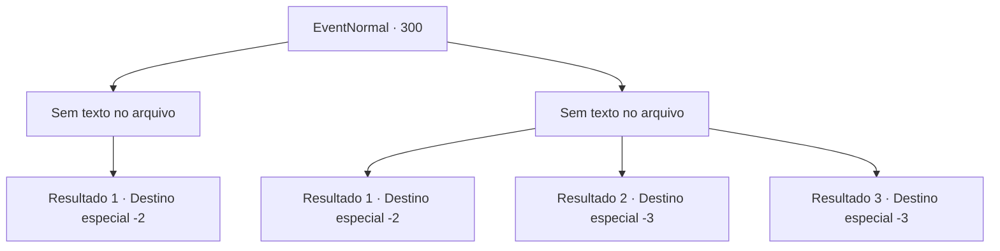

# Eventos normais · 300

[Índice da tabela](index.md) · [Índice geral](../index.md)

ID: `pt:EventNormal:300` · Fonte: `EventNormal4` · Versão: 1.2.47.

Mapeamento estático dos arquivos; a disponibilidade e a execução dependem do estado da run.

## Texto do evento

*Sem texto no arquivo.*

## Dados de entrada

```json
{
  "id": 300,
  "grade": 1,
  "place": "",
  "required": ""
}
```

## Mapa das escolhas



## Escolhas e resultados

### Escolha 1

*Sem texto no arquivo; o papel dessa opção depende da interface do jogo.*

Requisitos e outros campos da escolha:

```json
{
  "required": ""
}
```

#### Resultado 1.1

Você corta os guerreiros orcs um por um e finalmente corta também o comandante orc. Com o comandante derrotado, os orcs murmuram em pânico e logo fogem depois de hesitar por um tempo. Você pega o machado de batalha do comandante e retorna para Adela. Logo em seguida, você volta para Adela, ensopado de sangue orc. Assustado, ele ordena que seu servo traga uma toalha. Enquanto o servo lava o sangue do seu corpo, Adela fala com você primeiro. 

 "O que aconteceu...!?"

 Você conta a ele tudo o que aconteceu, apresentando o machado de batalha como evidência. Adela fica muito satisfeito. Após agradecer pelo seu serviço, ele lhe presenteia com uma caixa cheia de moedas de ouro.

Continuação registrada: [Destino especial `-2`](../destinos-especiais.md).

```json
{
  "required": "",
  "chance": "1",
  "nextEvent": -2,
  "type": 2,
  "reward": "0_2_1|0_4_200|3_208_1"
}
```

### Escolha 2

*Sem texto no arquivo; o papel dessa opção depende da interface do jogo.*

Requisitos e outros campos da escolha:

```json
{
  "required": ""
}
```

#### Resultado 2.1

Você derruba guerreiros orcs um por um, mas o golpe do comandante acerta seu ombro. Felizmente, sua resistência poderosa abriu uma janela de escape em sua formação. Aproveitando a oportunidade, você foge, segurando seu ombro pela ferida.

Continuação registrada: [Destino especial `-2`](../destinos-especiais.md).

```json
{
  "required": "1_0_2|1_1_2",
  "chance": "1",
  "nextEvent": -2,
  "type": 2,
  "reward": ""
}
```

#### Resultado 2.2

Você derruba guerreiros orcs um por um, mas o golpe do comandante acerta seu ombro. Você rapidamente aplica pressão no seu ombro, mas o sangramento parece não parar. À medida que sente sua consciência se esvaindo, você desmaia após ser atingido por um machado de batalha gigante.

Continuação registrada: [Destino especial `-3`](../destinos-especiais.md).

```json
{
  "required": "2_0_2",
  "chance": "1",
  "nextEvent": -3,
  "type": 2,
  "reward": "0_0_-1|0_1_-1"
}
```

#### Resultado 2.3

Você derruba guerreiros orcs um por um, mas o golpe do comandante acerta seu ombro. Você rapidamente aplica pressão no seu ombro, mas o sangramento não parece parar. À medida que sente sua consciência desaparecendo, você desmaia depois de ser atingido por um machado de batalha gigante.

Continuação registrada: [Destino especial `-3`](../destinos-especiais.md).

```json
{
  "required": "2_1_2",
  "chance": "1",
  "nextEvent": -3,
  "type": 2,
  "reward": "0_0_-1|0_1_-1"
}
```

## Referências que chegam a este evento

- [Evento 299 · escolha 1 · resultado 1](0299.md#escolha-1)
