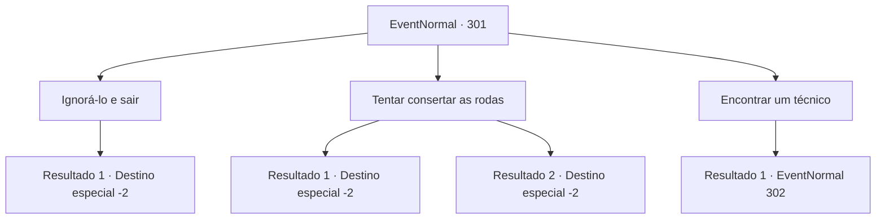

# Eventos normais · 301

[Índice da tabela](index.md) · [Índice geral](../index.md)

ID: `pt:EventNormal:301` · Fonte: `EventNormal4` · Versão: 1.2.47.

Mapeamento estático dos arquivos; a disponibilidade e a execução dependem do estado da run.

## Texto do evento

Enquanto você está caminhando por um caminho acidentado, você encontra uma carruagem com as rodas quebradas. Um homem musculoso que parece ser o cocheiro está coçando a nuca, deixado em uma situação difícil. Seu rosto está encharcado de suor, provavelmente devido as suas tentativas de consertar a carruagem.

## Dados de entrada

```json
{
  "id": 301,
  "grade": 1,
  "place": "",
  "required": "5_191_0"
}
```

## Mapa das escolhas



## Escolhas e resultados

### Escolha 1

Ignorá-lo e sair

Requisitos e outros campos da escolha:

```json
{
  "required": ""
}
```

#### Resultado 1.1

Você passa pelo homem em aflição. Ele te encara enquanto você passa, mas logo volta a tentar consertar a diligência com suas ferramentas.

Continuação registrada: [Destino especial `-2`](../destinos-especiais.md).

```json
{
  "required": "",
  "chance": "1",
  "nextEvent": -2,
  "type": 2,
  "reward": "5_191_1"
}
```

### Escolha 2

Tentar consertar as rodas

Requisitos e outros campos da escolha:

```json
{
  "required": ""
}
```

#### Resultado 2.1

Tentas consertar a diligência, usando as tuas habilidades em habilidade manual. 

 "Agradeço. Se conseguires fazer esta coisa funcionar novamente, vou garantir que te pague bem."

 Acenas com a cabeça e dás uma olhada na condição da roda. A parte que conecta cada roda parece estar quebrada. Após uma cuidadosa consideração, retiras a roda quebrada da diligência com a ajuda do cocheiro e removes a parte que precisava de conserto. Em seguida, improvisas um substituto temporário para a parte quebrada usando ferramentas e a colocas de volta na roda. Ela faz alguns ruídos rangentes, mas a diligência está operacional novamente. 

 "Ooh! Muito obrigado! Aventureiro bondoso!"

 Ele agradece e te entrega um pouco de ouro.

Continuação registrada: [Destino especial `-2`](../destinos-especiais.md).

```json
{
  "required": "",
  "chance": "1|0_7_1",
  "nextEvent": -2,
  "type": 0,
  "reward": "0_2_1|5_191_1|0_4_30|0_3_1"
}
```

#### Resultado 2.2

você tenta consertar a diligência, usando suas habilidades em habilidade manual. 

 "Agradeço. Se você conseguir fazer essa coisa funcionar novamente, vou garantir que te pague bem."

 Você acena com a cabeça e verifica a condição da roda. A parte que conecta cada roda parece estar quebrada. Após uma cuidadosa consideração, você remove a roda quebrada da diligência com a ajuda do cocheiro e retira a parte que precisava ser consertada. Em seguida, você improvisa um substituto temporário para a parte quebrada usando ferramentas e a coloca de volta na roda. Mas, contrariando suas expectativas, a diligência quebra completamente. O cocheiro franze a testa, reclamando com você. 

 "Maldição! Você não está ajudando em nada!"

 Você deixa o homem batendo no peito em irritação e vai embora.

Continuação registrada: [Destino especial `-2`](../destinos-especiais.md).

```json
{
  "required": "",
  "chance": "14",
  "nextEvent": -2,
  "type": 1,
  "reward": "5_191_1"
}
```

### Escolha 3

Encontrar um técnico

Requisitos e outros campos da escolha:

```json
{
  "required": ""
}
```

#### Resultado 3.1

Você diz a ele que trará um técnico que pode consertar uma carruagem de uma vila próxima. 

 "Eu agradeceria isso. Cerca de... 30 ouros seriam suficientes para contratar um técnico. Vou esperar aqui, então."

 Você passa por uma vila próxima e pergunta por um técnico. Um homem chamado 'Ben' de um estábulo diz que sabe como consertar uma carruagem, e pergunta qual seria o pagamento.

Continuação registrada: [Evento 302](0302.md) na mesma tabela.

```json
{
  "required": "",
  "chance": "1",
  "nextEvent": 302,
  "type": 2,
  "reward": "5_191_1"
}
```

## Referências que chegam a este evento

Nenhum `nextEvent` positivo da mesma tabela aponta para este nó. Isso não prova que seja inacessível: sorteio e estado de história podem selecioná-lo.

