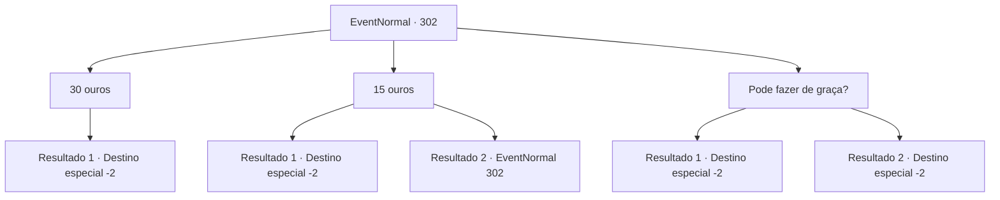

# Eventos normais · 302

[Índice da tabela](index.md) · [Índice geral](../index.md)

ID: `pt:EventNormal:302` · Fonte: `EventNormal4` · Versão: 1.2.47.

Mapeamento estático dos arquivos; a disponibilidade e a execução dependem do estado da run.

## Texto do evento

*Sem texto no arquivo.*

## Dados de entrada

```json
{
  "id": 302,
  "grade": 1,
  "place": "",
  "required": ""
}
```

## Mapa das escolhas



## Escolhas e resultados

### Escolha 1

30 ouros

Requisitos e outros campos da escolha:

```json
{
  "required": ""
}
```

#### Resultado 1.1

Você sugere 30 ouro. Ele aceita felizmente sua oferta e te segue. Logo, Ben chega na diligência quebrada e começa seu trabalho. O cocheiro te entrega um pouco de ouro, com palavras de gratidão. 

 "Obrigado pela ajuda. Algo pequeno, então por favor, pegue."

 Você pega o ouro e se despede dele.

Continuação registrada: [Destino especial `-2`](../destinos-especiais.md).

```json
{
  "required": "",
  "chance": "1",
  "nextEvent": -2,
  "type": 2,
  "reward": "5_191_1|0_4_10"
}
```

### Escolha 2

15 ouros

Requisitos e outros campos da escolha:

```json
{
  "required": "5_192_0"
}
```

#### Resultado 2.1

Você sugere 15 ouro. Ele hesita por um tempo, mas logo acena com a cabeça e aceita sua oferta. Logo, Ben chega à diligência quebrada e começa seu trabalho. O cocheiro lhe entrega um pouco de ouro, com palavras de gratidão. 

 "Obrigado pela ajuda. Algo pequeno, então por favor, pegue."

 Você pega o ouro e se despede dele.

Continuação registrada: [Destino especial `-2`](../destinos-especiais.md).

```json
{
  "required": "",
  "chance": "1|0_12_1",
  "nextEvent": -2,
  "type": 0,
  "reward": "0_4_20"
}
```

#### Resultado 2.2

Você sugere 15 ouro. Ele hesita por um momento, balança a cabeça e fala. 

 "Vamos lá... isso é muito barato da sua parte. Pelo menos 30 ouro seria suficiente"

.

Continuação registrada: [Evento 302](0302.md) na mesma tabela.

```json
{
  "required": "",
  "chance": "12",
  "nextEvent": 302,
  "type": 1,
  "reward": "5_192_1"
}
```

### Escolha 3

Pode fazer de graça?

Requisitos e outros campos da escolha:

```json
{
  "required": "5_192_0"
}
```

#### Resultado 3.1

Você 'educadamente' pede para empregar seus serviços de graça. Ele acena com a cabeça, assustado, e aceita sua oferta. Logo, Ben chega à diligência quebrada e começa seu trabalho. O cocheiro lhe entrega um pouco de ouro, com palavras de gratidão. 

 "Obrigado pela ajuda. Um pequeno presente, por favor, aceite."

 Você pega o ouro e se despede dele.

Continuação registrada: [Destino especial `-2`](../destinos-especiais.md).

```json
{
  "required": "20_1_2",
  "chance": "1",
  "nextEvent": -2,
  "type": 2,
  "reward": "0_3_-1|0_4_30"
}
```

#### Resultado 3.2

Você pede a ele para fazer isso de graça. Mas ele balança a cabeça e fala. 

 "Hmph... não vai acontecer."

 Ele então volta furiosamente para dentro do estábulo. Você não tem escolha a não ser ir para outro lugar.

Continuação registrada: [Destino especial `-2`](../destinos-especiais.md).

```json
{
  "required": "21_1_2",
  "chance": "1",
  "nextEvent": -2,
  "type": 2,
  "reward": ""
}
```

## Referências que chegam a este evento

- [Evento 301 · escolha 3 · resultado 1](0301.md#escolha-3)
- [Evento 302 · escolha 2 · resultado 2](0302.md#escolha-2)
