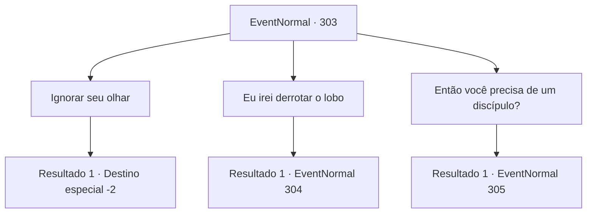

# Eventos normais · 303

[Índice da tabela](index.md) · [Índice geral](../index.md)

ID: `pt:EventNormal:303` · Fonte: `EventNormal4` · Versão: 1.2.47.

Mapeamento estático dos arquivos; a disponibilidade e a execução dependem do estado da run.

## Texto do evento

Você acaba descansando em uma cabana que pertence a uma mulher do campo. Quando você está prestes a terminar o dia na cama que ela preparou, você ouve uma voz familiar de um homem discutindo em voz alta com a mulher. Quando você sai pela porta, surpreso com o barulho, você vê Ron Quixote parado do lado de fora com um galho de árvore. Ron Quixote te vê e pergunta, surpreso. 

 "Huh! Você não é o aventureiro que vi da última vez? Você tem me seguido, na esperança de se tornar meu aluno?"

 A camponesa suspira e depois explica. Segundo ela, Ron Quixote é seu irmão mais velho, e ela sofre com o comportamento dele há bastante tempo. 

 "Ele sempre volta para esta casa, e sempre fala em derrotar o lobo que ameaça esta cidade."

 Ron Quixote grita depois de ouvi-la. 

 "Um lobo! Eu vi com meus próprios olhos da última vez, aquela besta deve ser o cão do inferno!"

 A mulher balança a cabeça, tentando entender isso, e olha para você com olhos desesperados.

## Dados de entrada

```json
{
  "id": 303,
  "grade": 1,
  "place": "",
  "required": "5_166_1"
}
```

## Mapa das escolhas



## Escolhas e resultados

### Escolha 1

Ignorar seu olhar

Requisitos e outros campos da escolha:

```json
{
  "required": ""
}
```

#### Resultado 1.1

Você realmente não queria se envolver nessa questão, então ignora o olhar desesperado da mulher e volta para o seu quarto. Ainda é possível ouvir os dois discutindo lá fora, mas você tenta dormir, enfiando os olhos em um travesseiro. No dia seguinte, você sai de casa sentindo o olhar penetrante da mulher em suas costas. Ron Quixote não está em lugar algum.

Continuação registrada: [Destino especial `-2`](../destinos-especiais.md).

```json
{
  "required": "",
  "chance": "1",
  "nextEvent": -2,
  "type": 2,
  "reward": "5_166_2"
}
```

### Escolha 2

Eu irei derrotar o lobo

Requisitos e outros campos da escolha:

```json
{
  "required": ""
}
```

#### Resultado 2.1

Você diz a Ron Quixote que você vai se livrar do lobo, em vez dele. A mulher do campo pega sua mão alegremente, mas Ron Quixote grita, com o rosto vermelho. 

 "O quê! Um mero aventureiro como você não pode enfrentar o cão infernal e sobreviver! Essa tarefa só pode ser concluída por cavaleiros honrados!"

 Você ignora Ron Quixote e fala com a mulher. Ela diz que há rumores de um lobo com uma juba cinza, descendo uma montanha próxima de tempos em tempos, tirando a vida dos aldeões. Depois de receber as informações, você ignora Ron Quixote e descansa em seu quarto. No dia seguinte, você encontra o lobo de juba cinza, enquanto explora a montanha ao redor da vila.

Continuação registrada: [Evento 304](0304.md) na mesma tabela.

```json
{
  "required": "",
  "chance": "1",
  "nextEvent": 304,
  "type": 2,
  "reward": "6_0_3|5_166_2",
  "place": 1
}
```

### Escolha 3

Então você precisa de um discípulo?

Requisitos e outros campos da escolha:

```json
{
  "required": ""
}
```

#### Resultado 3.1

Você pergunta a Ron Quixote sobre ter um pupilo. Ele ri alto, colocando a mão no seu ombro. 

 "Ahahaha! Claro que é assim! Tudo bem, vou te conceder o privilégio de se tornar meu pupilo! Vamos pegar o cão infernal assim que o sol nascer amanhã, então certifique-se de descansar bem esta noite!"

 Deixando para trás a mulher olhando para vocês dois com uma expressão preocupada, você se retira para o seu quarto e descansa tranquilamente. No dia seguinte, você e Ron Quixote encontram o lobo de crina cinza, enquanto exploram a montanha ao redor da vila.

Continuação registrada: [Evento 305](0305.md) na mesma tabela.

```json
{
  "required": "",
  "chance": "1",
  "nextEvent": 305,
  "type": 2,
  "reward": "6_0_3|5_166_2",
  "place": 1
}
```

## Referências que chegam a este evento

Nenhum `nextEvent` positivo da mesma tabela aponta para este nó. Isso não prova que seja inacessível: sorteio e estado de história podem selecioná-lo.

