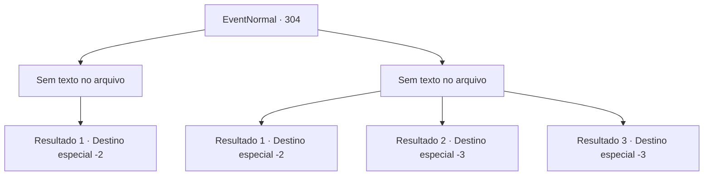

# Eventos normais · 304

[Índice da tabela](index.md) · [Índice geral](../index.md)

ID: `pt:EventNormal:304` · Fonte: `EventNormal4` · Versão: 1.2.47.

Mapeamento estático dos arquivos; a disponibilidade e a execução dependem do estado da run.

## Texto do evento

*Sem texto no arquivo.*

## Dados de entrada

```json
{
  "id": 304,
  "grade": 1,
  "place": "",
  "required": ""
}
```

## Mapa das escolhas



## Escolhas e resultados

### Escolha 1

*Sem texto no arquivo; o papel dessa opção depende da interface do jogo.*

Requisitos e outros campos da escolha:

```json
{
  "required": ""
}
```

#### Resultado 1.1

Você retorna à casa da mulher com o corpo morto do lobo cinzento em seus ombros. Ron Quixote, que não conseguiu sair da casa, olha para você com espanto. 

 "W, o quê?! Você realmente derrotou o cão do inferno!?"

 A mulher lhe presenteia com um salmão, por seus problemas. Enquanto você está prestes a sair com o presente da mulher, um problema inesperado ocorre. Ron Quixote está segurando seu tornozelo. 

 "Oh, grande senhor do cavaleiro! Faça deste Ron Quixote seu pupilo!"

 Antes que você possa responder, sua irmã o dá um tapa nas costas, arrastando-o para o quarto dele. Logo em seguida, ela sai e fala. 

 "Desculpe por isso. Vá embora, antes que aquele homem... Ron Quixote te incomode mais."

 Você se despede dela e deixa a vila.

Continuação registrada: [Destino especial `-2`](../destinos-especiais.md).

```json
{
  "required": "",
  "chance": "1",
  "nextEvent": -2,
  "type": 2,
  "reward": "3_144_1"
}
```

### Escolha 2

*Sem texto no arquivo; o papel dessa opção depende da interface do jogo.*

Requisitos e outros campos da escolha:

```json
{
  "required": ""
}
```

#### Resultado 2.1

O cão infernal sobre o qual Ron Quixote falou realmente ameaça sua vida, como se fosse realmente um cão do inferno. Após evitar um ferimento fatal, você consegue fugir com sua vida. Quando você retorna à casa da mulher, Ron Quixote ri de você, mastigando algumas batatas cozidas. 

 "Hahaha! O que eu disse? Apenas um cavaleiro honrado pode combater o cão do inferno."

 Você foge dos deboches de Ron Quixote, longe da vila.

Continuação registrada: [Destino especial `-2`](../destinos-especiais.md).

```json
{
  "required": "1_0_2|1_1_2",
  "chance": "1",
  "nextEvent": -2,
  "type": 2,
  "reward": "0_0_-1|0_1_-1"
}
```

#### Resultado 2.2

O cão infernal sobre o qual Ron Quixote falou realmente ameaça sua vida, como se fosse realmente um cão do inferno. Você faz tudo o que pode para lutar contra o lobo, mas infelizmente, ele acaba com sua vida com uma mordida no pescoço.

Continuação registrada: [Destino especial `-3`](../destinos-especiais.md).

```json
{
  "required": "2_0_2",
  "chance": "1",
  "nextEvent": -3,
  "type": 2,
  "reward": "0_0_-1|0_1_-1"
}
```

#### Resultado 2.3

O cão infernal sobre o qual Ron Quixote falou realmente ameaça sua vida, como se fosse realmente um cão do inferno. Você faz tudo o que pode para lutar contra o lobo, mas infelizmente, ele acaba com sua vida com uma mordida no pescoço.

Continuação registrada: [Destino especial `-3`](../destinos-especiais.md).

```json
{
  "required": "2_1_2",
  "chance": "1",
  "nextEvent": -3,
  "type": 2,
  "reward": "0_0_-1|0_1_-1"
}
```

## Referências que chegam a este evento

- [Evento 303 · escolha 2 · resultado 1](0303.md#escolha-2)
