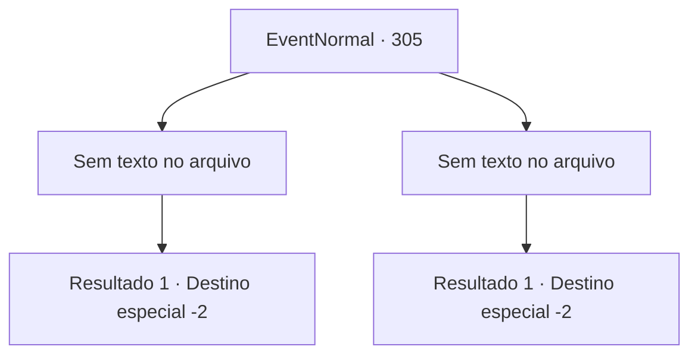

# Eventos normais · 305

[Índice da tabela](index.md) · [Índice geral](../index.md)

ID: `pt:EventNormal:305` · Fonte: `EventNormal4` · Versão: 1.2.47.

Mapeamento estático dos arquivos; a disponibilidade e a execução dependem do estado da run.

## Texto do evento

*Sem texto no arquivo.*

## Dados de entrada

```json
{
  "id": 305,
  "grade": 1,
  "place": "",
  "required": ""
}
```

## Mapa das escolhas



## Escolhas e resultados

### Escolha 1

*Sem texto no arquivo; o papel dessa opção depende da interface do jogo.*

Requisitos e outros campos da escolha:

```json
{
  "required": ""
}
```

#### Resultado 1.1

Quando o lobo aparece, Ron Quixote pega sua velha espada, Porém ele tropeça em uma pedra e desmaia, sem causar danos ao lobo. Você olha para ele, pasmo, mas logo se concentra na luta com o lobo. Logo, você volta para a casa da mulher, arrastando o cadáver do lobo e o inconsciente Ron Quixote. Ela agradece e te presenteia com um salmão.

Continuação registrada: [Destino especial `-2`](../destinos-especiais.md).

```json
{
  "required": "",
  "chance": "1",
  "nextEvent": -2,
  "type": 2,
  "reward": "3_144_1"
}
```

### Escolha 2

*Sem texto no arquivo; o papel dessa opção depende da interface do jogo.*

Requisitos e outros campos da escolha:

```json
{
  "required": ""
}
```

#### Resultado 2.1

O Hellhound, Ron Quixote, falou sobre realmente ameaça sua vida, como se realmente fosse um cão do inferno. Então, quando você fica para trás do movimento ágil do lobo e permite uma janela de fraqueza, Ron Quixote corre valentemente, levando o ataque. Graças a isso, você é capaz de se levantar, dirigindo a espada pelo corpo do lobo, mas as feridas de Ron Quixote são muito profundas. Levando o cadáver de Ron Quixote, você volta para a cabana da mulher. Ela derrama lágrimas depois de ver o cadáver de seu irmão. 

 "*SOB*... eu ... eu disse a ele para não ir ..."

 Junto com a mulher que você o enterra em um terreno próximo. 

 'Valiant Knight Ron Quixote, deitado para descansar.' 

 Depois de gravar as palavras, você paga respeito e retorna às suas aventuras. 

Continuação registrada: [Destino especial `-2`](../destinos-especiais.md).

```json
{
  "required": "",
  "chance": "1",
  "nextEvent": -2,
  "type": 2,
  "reward": ""
}
```

## Referências que chegam a este evento

- [Evento 303 · escolha 3 · resultado 1](0303.md#escolha-3)
