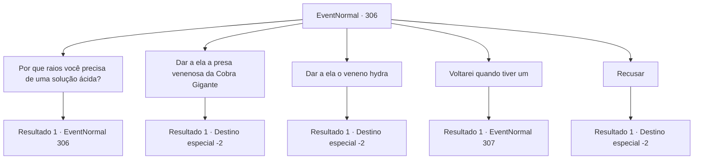

# Eventos normais · 306

[Índice da tabela](index.md) · [Índice geral](../index.md)

ID: `pt:EventNormal:306` · Fonte: `EventNormal4` · Versão: 1.2.47.

Mapeamento estático dos arquivos; a disponibilidade e a execução dependem do estado da run.

## Texto do evento

Em um lugar chamado 'Marley's Smithy' nos arredores da cidade, você encontra uma ferreira suspirando profundamente. Quando ela te vê passando, ela deixa cair a pinça em suas mãos e se aproxima de você. 

 "Ei, espere um minuto..! Me ajude aqui."

 Antes que você consiga responder, ela começa a falar. 

 "Eu preciso fazer um escudo e estou sem solução ácida. Você pode me arranjar um pouco de ácido forte?"


## Dados de entrada

```json
{
  "id": 306,
  "grade": 1,
  "place": "",
  "required": "5_201_0"
}
```

## Mapa das escolhas



## Escolhas e resultados

### Escolha 1

Por que raios você precisa de uma solução ácida?

Requisitos e outros campos da escolha:

```json
{
  "required": "5_201_0"
}
```

#### Resultado 1.1

O ferreiro responde com um suspiro profundo. 

 "Bem, um dos nobres de alta posição solicitou um escudo com padrão de ondas.. Mas esse padrão não pode ser gravado no metal, o próprio metal tem que ter um padrão de ondas, e para criar tal padrão, tenho que mergulhar o metal em ácido durante o processo."


Continuação registrada: [Evento 306](0306.md) na mesma tabela.

```json
{
  "required": "",
  "chance": "1",
  "nextEvent": 306,
  "type": 2,
  "reward": "5_201_1"
}
```

### Escolha 2

Dar a ela a presa venenosa da Cobra Gigante

Requisitos e outros campos da escolha:

```json
{
  "required": "8_56_1"
}
```

#### Resultado 2.1

Você entrega a ela uma presa venenosa de uma cobra gigante. Ela a recebe, usando luvas grossas. 

 "Ooh... isso parece legal. Vou tentar. Espere um pouco."

 O ferreiro extrai o veneno da presa e o mistura com óleo. Uma aura roxa fraca aparece na superfície do óleo. Ela pega um escudo moldado e o coloca dentro de uma fornalha. Alguns segundos depois, ela retira o escudo aquecido e o mergulha no óleo. O escudo agora tem um padrão de ondas limpo e bonito. 

 "Ótimo! O trabalho está completo. Obrigado."

 Ela sorri e agradece a você. Então ela coloca o escudo dentro de uma luxuosa caixa de couro. 

 "Obrigado novamente por ajudar. Aqui, pelo seu trabalho."

 Ela lhe entrega algum ouro, e você sai da ferraria com a recompensa.

Continuação registrada: [Destino especial `-2`](../destinos-especiais.md).

```json
{
  "required": "",
  "chance": "1",
  "nextEvent": -2,
  "type": 2,
  "reward": "5_201_2|0_4_20|4_56_1"
}
```

### Escolha 3

Dar a ela o veneno hydra

Requisitos e outros campos da escolha:

```json
{
  "required": "8_133_1"
}
```

#### Resultado 3.1

Você entrega a ela o veneno da hidra. Ela o recebe, usando luvas grossas. 

 "Veneno da hidra... Impressionante... como você conseguiu isso? Vou tentar. Espere um pouco."

 O ferreiro extrai o veneno e o mistura com óleo. Uma aura verde sinistra aparece no óleo. Ela pega um escudo moldado e o coloca dentro de uma fornalha. Alguns segundos depois, ela retira o escudo aquecido e o mergulha no óleo. 

 "Ah... Maldição!"

 Ela xinga ao deixar cair o escudo. O escudo tem um padrão de ondas forte, mas se despedaça assim que toca o chão. 

 "Talvez o ácido tenha sido muito forte... agora vamos enfraquecê-lo..."

 Ela murmura para si mesma em voz baixa e repete o mesmo processo novamente. O escudo acaba ficando com um padrão de ondas limpo e bonito. 

 "Ótimo! O trabalho está completo. Obrigada."

 Ela sorri e agradece. Então ela coloca o escudo dentro de uma luxuosa caixa de couro. 

 "Obrigada novamente por ajudar. Aqui, pelo seu trabalho."

 Ela lhe entrega algum ouro e você sai da ferraria com a recompensa.

Continuação registrada: [Destino especial `-2`](../destinos-especiais.md).

```json
{
  "required": "",
  "chance": "1",
  "nextEvent": -2,
  "type": 2,
  "reward": "5_201_2|0_4_100|4_133_1"
}
```

### Escolha 4

Voltarei quando tiver um

Requisitos e outros campos da escolha:

```json
{
  "required": ""
}
```

#### Resultado 4.1

Você diz a ela que voltará quando encontrar um. Mas ela insiste que precisa disso agora mesmo e pede para você pegar emprestado alguns da ferraria localizada no centro da cidade. 

 "Mas não mencione meu nome. Eu... não estou em bons termos com o ferreiro lá."

 Então você visita a ferraria na área mais desenvolvida da cidade, chamada 'A Bigorna dos Gigantes'. O ferreiro aqui é um anão e ele pergunta sem nem mesmo olhar para você, sua mente focada em martelar. 

 "O que você quer?!"


Continuação registrada: [Evento 307](0307.md) na mesma tabela.

```json
{
  "required": "",
  "chance": "1",
  "nextEvent": 307,
  "type": 2,
  "reward": ""
}
```

### Escolha 5

Recusar

Requisitos e outros campos da escolha:

```json
{
  "required": ""
}
```

#### Resultado 5.1

Você recusa a oferta dela. Ela cruza os braços e olha fixamente para você com uma expressão infeliz, mas você a deixa para trás, seguindo em frente.

Continuação registrada: [Destino especial `-2`](../destinos-especiais.md).

```json
{
  "required": "",
  "chance": "1",
  "nextEvent": -2,
  "type": 2,
  "reward": "5_201_9"
}
```

## Referências que chegam a este evento

- [Evento 306 · escolha 1 · resultado 1](0306.md#escolha-1)
