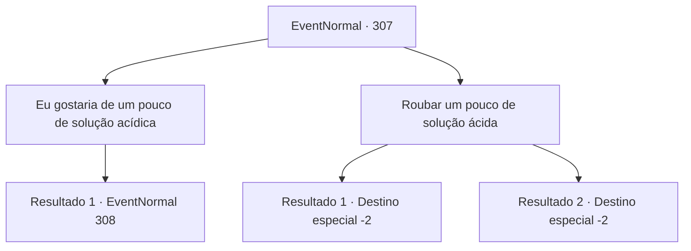

# Eventos normais · 307

[Índice da tabela](index.md) · [Índice geral](../index.md)

ID: `pt:EventNormal:307` · Fonte: `EventNormal4` · Versão: 1.2.47.

Mapeamento estático dos arquivos; a disponibilidade e a execução dependem do estado da run.

## Texto do evento

*Sem texto no arquivo.*

## Dados de entrada

```json
{
  "id": 307,
  "grade": 1,
  "place": "",
  "required": ""
}
```

## Mapa das escolhas



## Escolhas e resultados

### Escolha 1

Eu gostaria de um pouco de solução acídica

Requisitos e outros campos da escolha:

```json
{
  "required": ""
}
```

#### Resultado 1.1

O ferreiro ouve o seu pedido, acena com a cabeça e fala. 

 "Uh... vamos ver... aqui está. 50 ouro resolverá."

 Ele mostra-lhe um frasco cheio de um líquido cristalino e diz para pagar.

Continuação registrada: [Evento 308](0308.md) na mesma tabela.

```json
{
  "required": "",
  "chance": "1",
  "nextEvent": 308,
  "type": 2,
  "reward": ""
}
```

### Escolha 2

Roubar um pouco de solução ácida

Requisitos e outros campos da escolha:

```json
{
  "required": ""
}
```

#### Resultado 2.1

Você procura uma solução ácida enquanto o ferreiro não está olhando para você. Em seguida, você encontra um frasco de vidro marcado com crânio cheio de líquido cristalino. Você faz algumas perguntas sem sentido e se desloca com o frasco de vidro na sua mão. 

 Alguns minutos depois, você retorna à Smithy nos arredores com o frasco de vidro. Ela abre, cheira o líquido e assente. 

 "Sim. Obrigado por ajudar."

 Ela mistura a solução ácida com o óleo, pega um escudo em forma e o coloca no forno. Alguns segundos depois, ela pega o escudo aquecido e mergulha no óleo. O escudo agora tem um padrão de onda limpo e bonito. 

 "Excelente! O trabalho está completo. Obrigada."

 Ela sorri e obrigado. Então ela coloca o escudo dentro de uma luxuosa caixa de couro. 

 "Obrigado novamente, por ajudar. Aqui, para o seu problema."

 Ela lhe entrega um pouco de ouro e você deixa a ferraria com a recompensa.

Continuação registrada: [Destino especial `-2`](../destinos-especiais.md).

```json
{
  "required": "",
  "chance": "1|0_6_1",
  "nextEvent": -2,
  "type": 0,
  "reward": "5_201_2|0_4_20"
}
```

#### Resultado 2.2

Você procura por uma solução ácida enquanto o ferreiro não está olhando para você. Então você encontra um frasco de vidro marcado com uma caveira cheio de líquido cristalino. Você faz algumas perguntas sem sentido e tenta escapar com o frasco de vidro em sua mão. Mas o ferreiro anão percebe seu comportamento. 

 "Este maldito miserável!!"

 Ele corre em sua direção com uma tenaz aquecida, e você foge antes de pegar fogo.

Continuação registrada: [Destino especial `-2`](../destinos-especiais.md).

```json
{
  "required": "",
  "chance": "11",
  "nextEvent": -2,
  "type": 1,
  "reward": "5_201_9"
}
```

## Referências que chegam a este evento

- [Evento 306 · escolha 4 · resultado 1](0306.md#escolha-4)
