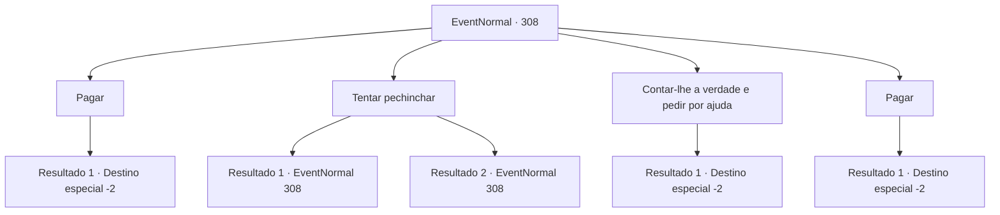

# Eventos normais · 308

[Índice da tabela](index.md) · [Índice geral](../index.md)

ID: `pt:EventNormal:308` · Fonte: `EventNormal4` · Versão: 1.2.47.

Mapeamento estático dos arquivos; a disponibilidade e a execução dependem do estado da run.

## Texto do evento

*Sem texto no arquivo.*

## Dados de entrada

```json
{
  "id": 308,
  "grade": 1,
  "place": "",
  "required": ""
}
```

## Mapa das escolhas



## Escolhas e resultados

### Escolha 1

Pagar

Requisitos e outros campos da escolha:

```json
{
  "required": "1_4_50|18_196_1"
}
```

#### Resultado 1.1

Você paga e compra a solução ácida do anão. 

 Alguns minutos depois, você retorna à Smithy nos arredores com o frasco de vidro. Ela abre, cheira o líquido e assente. 

 "Sim. Obrigado por ajudar."

 Ela mistura a solução ácida com o óleo, pega um escudo em forma e o coloca no forno. Alguns segundos depois, ela pega o escudo aquecido e mergulha no óleo. O escudo agora tem um padrão de onda limpo e bonito. 

 "Excelente! O trabalho está completo. Obrigada."

 Ela sorri e obrigado. Então ela coloca o escudo dentro de uma luxuosa caixa de couro. 

 "Obrigado novamente, por ajudar. Aqui, para o seu problema."

 Ela lhe entrega um pouco de ouro e você deixa a ferraria com a recompensa.

Continuação registrada: [Destino especial `-2`](../destinos-especiais.md).

```json
{
  "required": "",
  "chance": "1",
  "nextEvent": -2,
  "type": 2,
  "reward": "5_201_2|0_4_-50|0_4_20"
}
```

### Escolha 2

Tentar pechinchar

Requisitos e outros campos da escolha:

```json
{
  "required": "5_196_0"
}
```

#### Resultado 2.1

Você negocia com o anão, pedindo um preço mais barato. Ele olha nos seus olhos, solta um suspiro e concorda. 

 "Hm... tudo bem, tudo bem. 30 ouros."


Continuação registrada: [Evento 308](0308.md) na mesma tabela.

```json
{
  "required": "",
  "chance": "1|0_12_1",
  "nextEvent": 308,
  "type": 0,
  "reward": "5_196_1"
}
```

#### Resultado 2.2

Você negocia com o anão, pedindo um preço mais barato. Ele olha nos seus olhos, solta um suspiro e balança a cabeça.

Continuação registrada: [Evento 308](0308.md) na mesma tabela.

```json
{
  "required": "",
  "chance": "15",
  "nextEvent": 308,
  "type": 1,
  "reward": "5_196_2"
}
```

### Escolha 3

Contar-lhe a verdade e pedir por ajuda

Requisitos e outros campos da escolha:

```json
{
  "required": ""
}
```

#### Resultado 3.1

Você diz a ele que a Ferraria de Marley está precisando de uma solução ácida. Então, o anão larga seu martelo e sorri. 

 "Hahaha! Marley! Minha adorável noiva vem me pedir ajuda...! Não tenho escolha então!"

 Ele fica tão feliz que começa a dançar e lhe entrega um frasco de vidro com um símbolo de esqueleto. 

 "Certifique-se de entregá-lo a ela~! E não se esqueça de dizer a ela que fiquei feliz em ajudar!"

 Alguns minutos depois, você retorna à ferraria nos arredores com o frasco de vidro. Ela o abre, cheira o líquido e assente. 

 "Sim. Obrigada por ajudar."

 Ela mistura a solução ácida com o óleo, pega um escudo moldado e o coloca na fornalha. Alguns segundos depois, ela retira o escudo aquecido e o mergulha no óleo. O escudo agora tem um padrão de ondas limpo e bonito. 

 "Ótimo! O trabalho está completo. Obrigada."

 Ela sorri e agradece a você. Então ela coloca o escudo dentro de uma luxuosa caixa de couro. 

 "Obrigada novamente por ajudar. Aqui, por seus problemas."

 Ela lhe entrega algum ouro e você sai da ferraria com a recompensa.

Continuação registrada: [Destino especial `-2`](../destinos-especiais.md).

```json
{
  "required": "",
  "chance": "1",
  "nextEvent": -2,
  "type": 2,
  "reward": "5_201_3|0_4_20"
}
```

### Escolha 4

Pagar

Requisitos e outros campos da escolha:

```json
{
  "required": "1_4_30|5_196_1"
}
```

#### Resultado 4.1

Você paga e compra a solução ácida do anão. 

 Alguns minutos depois, você retorna à Smithy nos arredores com o frasco de vidro. Ela abre, cheira o líquido e assente. 

 "Sim. Obrigado por ajudar."

 Ela mistura a solução ácida com o óleo, pega um escudo em forma e o coloca no forno. Alguns segundos depois, ela pega o escudo aquecido e mergulha no óleo. O escudo agora tem um padrão de onda limpo e bonito. 

 "Excelente! O trabalho está completo. Obrigada."

 Ela sorri e obrigado. Então ela coloca o escudo dentro de uma luxuosa caixa de couro. 

 "Obrigado novamente, por ajudar. Aqui, para o seu problema."

 Ela lhe entrega um pouco de ouro e você deixa a ferraria com a recompensa.

Continuação registrada: [Destino especial `-2`](../destinos-especiais.md).

```json
{
  "required": "",
  "chance": "1",
  "nextEvent": -2,
  "type": 2,
  "reward": "5_201_2|0_4_-30|0_4_20"
}
```

## Referências que chegam a este evento

- [Evento 307 · escolha 1 · resultado 1](0307.md#escolha-1)
- [Evento 308 · escolha 2 · resultado 1](0308.md#escolha-2)
- [Evento 308 · escolha 2 · resultado 2](0308.md#escolha-2)
