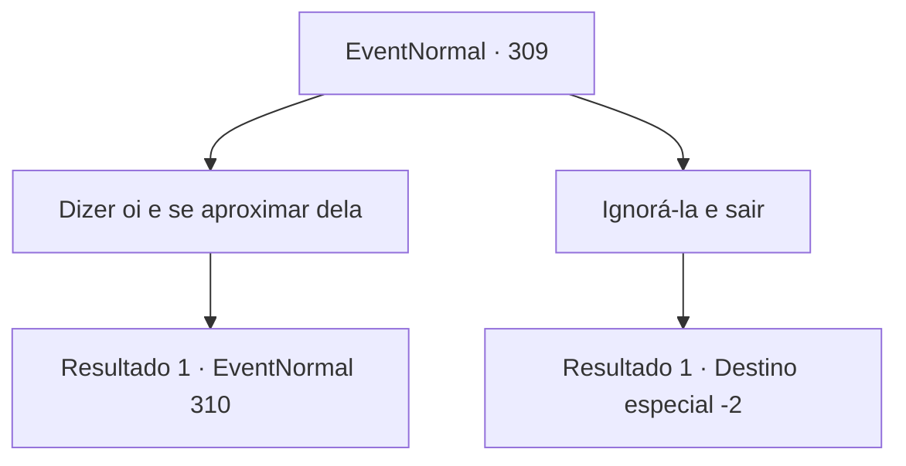

# Eventos normais · 309

[Índice da tabela](index.md) · [Índice geral](../index.md)

ID: `pt:EventNormal:309` · Fonte: `EventNormal4` · Versão: 1.2.47.

Mapeamento estático dos arquivos; a disponibilidade e a execução dependem do estado da run.

## Texto do evento

Você passa pelo 'Marley's Smithy' novamente. Desta vez, a ferreira está limpando o suor, descansando. Ela te vê, limpa as mãos e te cumprimenta. 

 "Ah! Oii. Tem um minuto?"

 Ao lado de seus pés está o escudo com padrão de ondas que ela fez da última vez.

## Dados de entrada

```json
{
  "id": 309,
  "grade": 2,
  "place": "",
  "required": "5_201_2"
}
```

## Mapa das escolhas



## Escolhas e resultados

### Escolha 1

Dizer oi e se aproximar dela

Requisitos e outros campos da escolha:

```json
{
  "required": ""
}
```

#### Resultado 1.1

Você cumprimenta calorosamente o ferreiro e se aproxima dela. Assim que ela se aproxima, ela começa a reclamar. 

 "Eu terminei o escudo com sua ajuda da última vez, mas... o nobre que encomendou de repente diz que se cansou do padrão de ondas! Então ele continua falando sobre como ele não vai comprar o escudo. Então ele fica preso aqui assim..."

 O ferreiro hesita em terminar a frase e continua, esperando sua resposta. 

 "Sabe... provavelmente vai vender se eu deixar aqui, mas com a ajuda que você me deu da última vez, eu estava pensando em vender isso para você com um preço mais barato. Que tal 80 ouros?"


Continuação registrada: [Evento 310](0310.md) na mesma tabela.

```json
{
  "required": "",
  "chance": "1",
  "nextEvent": 310,
  "type": 2,
  "reward": ""
}
```

### Escolha 2

Ignorá-la e sair

Requisitos e outros campos da escolha:

```json
{
  "required": ""
}
```

#### Resultado 2.1

Você ignora a saudação dela e sai apressadamente. Ela olha para as suas costas, abaixa a mão novamente e volta para a estação de trabalho dela.

Continuação registrada: [Destino especial `-2`](../destinos-especiais.md).

```json
{
  "required": "",
  "chance": "1",
  "nextEvent": -2,
  "type": 2,
  "reward": "5_201_9"
}
```

## Referências que chegam a este evento

Nenhum `nextEvent` positivo da mesma tabela aponta para este nó. Isso não prova que seja inacessível: sorteio e estado de história podem selecioná-lo.

