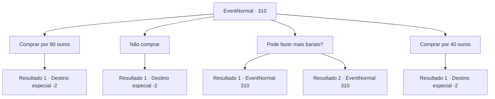

# Eventos normais · 310

[Índice da tabela](index.md) · [Índice geral](../index.md)

ID: `pt:EventNormal:310` · Fonte: `EventNormal4` · Versão: 1.2.47.

Mapeamento estático dos arquivos; a disponibilidade e a execução dependem do estado da run.

## Texto do evento

*Sem texto no arquivo.*

## Dados de entrada

```json
{
  "id": 310,
  "grade": 1,
  "place": "",
  "required": ""
}
```

## Mapa das escolhas



## Escolhas e resultados

### Escolha 1

Comprar por 80 ouros

Requisitos e outros campos da escolha:

```json
{
  "required": "1_4_80|18_197_1"
}
```

#### Resultado 1.1

Você aceita a oferta dela e compra o escudo. Ela parece aliviada, vendendo o produto restante assim. 

 "Parece um pouco estranho, mas funciona perfeitamente bem. Use-o bem."

 Você se despede dela e sai da ferraria.

Continuação registrada: [Destino especial `-2`](../destinos-especiais.md).

```json
{
  "required": "",
  "chance": "1",
  "nextEvent": -2,
  "type": 2,
  "reward": "0_4_-80|3_209_1|5_201_9"
}
```

### Escolha 2

Não comprar

Requisitos e outros campos da escolha:

```json
{
  "required": ""
}
```

#### Resultado 2.1

Você recusa a oferta dela. Ela lambe os lábios desapontada, e você vira as costas para ela e sai da ferraria.

Continuação registrada: [Destino especial `-2`](../destinos-especiais.md).

```json
{
  "required": "",
  "chance": "1",
  "nextEvent": -2,
  "type": 2,
  "reward": "5_201_9"
}
```

### Escolha 3

Pode fazer mais barato?

Requisitos e outros campos da escolha:

```json
{
  "required": "5_197_0"
}
```

#### Resultado 3.1

Você pede a ela para baixar o preço. Ao convencê-la com a ajuda que você forneceu na fabricação do escudo, ela cede e concorda, respondendo. 

 "Tudo bem. Vou aumentar um pouco e te dar pela metade do preço."


Continuação registrada: [Evento 310](0310.md) na mesma tabela.

```json
{
  "required": "",
  "chance": "1|0_12_1",
  "nextEvent": 310,
  "type": 0,
  "reward": "5_197_1"
}
```

#### Resultado 3.2

Você pede a ela para baixar o preço, mas ela balança a cabeça e responde. 

 "Desculpe, mas esse acordo vai me deixar no negativo."

 Ela parece não ter intenção de lhe dar um desconto.

Continuação registrada: [Evento 310](0310.md) na mesma tabela.

```json
{
  "required": "",
  "chance": "12",
  "nextEvent": 310,
  "type": 1,
  "reward": "5_197_2"
}
```

### Escolha 4

Comprar por 40 ouros

Requisitos e outros campos da escolha:

```json
{
  "required": "1_4_40|5_197_1"
}
```

#### Resultado 4.1

Você aceita a oferta dela e compra o escudo. Ela parece aliviada, vendendo o produto restante assim. 

 "Parece um pouco estranho, mas funciona perfeitamente bem. Use-o bem."

 Você se despede dela e sai da ferraria.

Continuação registrada: [Destino especial `-2`](../destinos-especiais.md).

```json
{
  "required": "",
  "chance": "1",
  "nextEvent": -2,
  "type": 2,
  "reward": "0_4_-40|3_209_1|5_201_9"
}
```

## Referências que chegam a este evento

- [Evento 309 · escolha 1 · resultado 1](0309.md#escolha-1)
- [Evento 310 · escolha 3 · resultado 1](0310.md#escolha-3)
- [Evento 310 · escolha 3 · resultado 2](0310.md#escolha-3)
