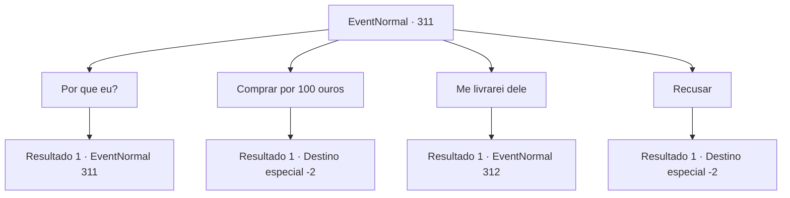

# Eventos normais · 311

[Índice da tabela](index.md) · [Índice geral](../index.md)

ID: `pt:EventNormal:311` · Fonte: `EventNormal4` · Versão: 1.2.47.

Mapeamento estático dos arquivos; a disponibilidade e a execução dependem do estado da run.

## Texto do evento

Você acaba passando pela 'Ferraria Marley' novamente. Você também encontra um anão de aparência suspeita, demorando-se na frente da ferraria. Ele te vê, fica surpreso e limpa as mãos. 

 "I-isso não é o que você pensa que é! Eu estava apenas... hã? Você não é o aventureiro que pegou a solução da última vez?"

 É o ferreiro anão no centro da cidade, e ele parece feliz em vê-lo novamente, reconhecendo seu rosto. Então, a dona sai da ferraria. Ela vê o anão e balança a cabeça, como se estivesse irritada. 

 "Qual é o problema desta vez?"

 O anão tenta responder, mas sem o ouvir, ela agarra você pelo pulso e te arrasta para dentro da ferraria. Então ela fala mais uma vez. 

 "Eu disse para você não falar nada sobre mim...!"

 Ela range os dentes, culpando você. De acordo com suas palavras, o ferreiro anão está tentando flertar com ela há muito tempo, e sua atitude tem estado muito mais confiante desde que ela recebeu aquela solução ácida. 

 "No momento certo. O escudo que fiz da última vez? Há um sobrando. Compre por 100 ouros."


## Dados de entrada

```json
{
  "id": 311,
  "grade": 2,
  "place": "",
  "required": "5_201_3"
}
```

## Mapa das escolhas



## Escolhas e resultados

### Escolha 1

Por que eu?

Requisitos e outros campos da escolha:

```json
{
  "required": "5_198_0"
}
```

#### Resultado 1.1

Ela responde à sua pergunta com um tom cínico. 

 "Porque você deu motivo para aquele maldito anão falar comigo. Eu pretendo... me livrar daquele anão com o dinheiro que você paga pelo escudo."


Continuação registrada: [Evento 311](0311.md) na mesma tabela.

```json
{
  "required": "",
  "chance": "1",
  "nextEvent": 311,
  "type": 2,
  "reward": "5_198_1"
}
```

### Escolha 2

Comprar por 100 ouros

Requisitos e outros campos da escolha:

```json
{
  "required": "1_4_100"
}
```

#### Resultado 2.1

Você aceita a oferta dela e compra o escudo. Ela parece aliviada, vendendo o produto restante assim. 

 "Parece um pouco estranho, mas funciona perfeitamente bem. Use-o bem."

 Você se despede dela e sai da ferraria.

Continuação registrada: [Destino especial `-2`](../destinos-especiais.md).

```json
{
  "required": "",
  "chance": "1",
  "nextEvent": -2,
  "type": 2,
  "reward": "0_4_-100|3_209_1|5_201_9"
}
```

### Escolha 3

Me livrarei dele

Requisitos e outros campos da escolha:

```json
{
  "required": "5_198_1"
}
```

#### Resultado 3.1

Você sugere que você pode se livrar do anão em vez disso. Ela te examina dos pés à cabeça e continua. 

 "Hmm... se você fizer isso, eu te darei esse escudo de graça."

 Você se aproxima do ferreiro anão, esticando seus tornozelos e pulsos. Ele te encara e fala. 

 "Huh? Tem algo a dizer?"


Continuação registrada: [Evento 312](0312.md) na mesma tabela.

```json
{
  "required": "",
  "chance": "1",
  "nextEvent": 312,
  "type": 2,
  "reward": ""
}
```

### Escolha 4

Recusar

Requisitos e outros campos da escolha:

```json
{
  "required": ""
}
```

#### Resultado 4.1

Você recusa a oferta dela. Você deixa o ferreiro surpreso e se afasta da ferraria.

Continuação registrada: [Destino especial `-2`](../destinos-especiais.md).

```json
{
  "required": "",
  "chance": "1",
  "nextEvent": -2,
  "type": 2,
  "reward": "5_201_9"
}
```

## Referências que chegam a este evento

- [Evento 311 · escolha 1 · resultado 1](0311.md#escolha-1)
