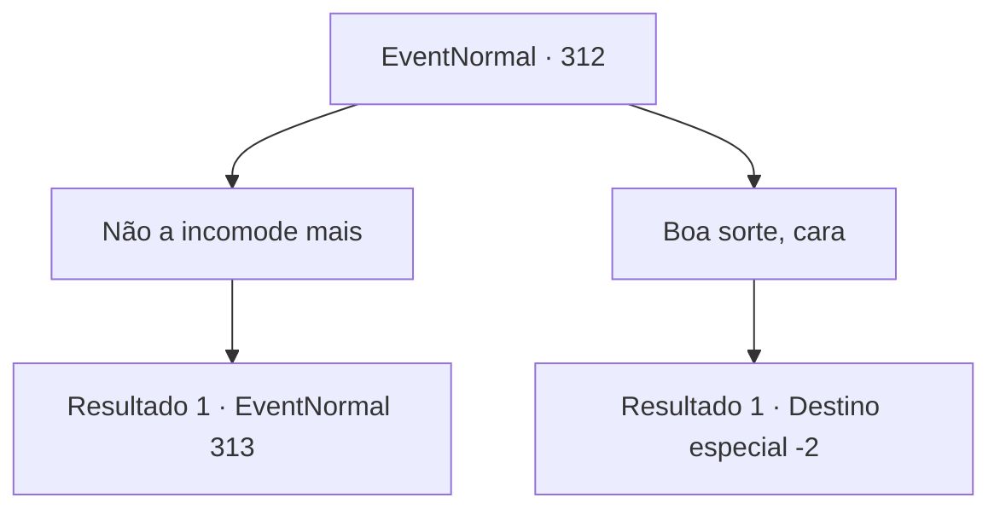

# Eventos normais · 312

[Índice da tabela](index.md) · [Índice geral](../index.md)

ID: `pt:EventNormal:312` · Fonte: `EventNormal4` · Versão: 1.2.47.

Mapeamento estático dos arquivos; a disponibilidade e a execução dependem do estado da run.

## Texto do evento

*Sem texto no arquivo.*

## Dados de entrada

```json
{
  "id": 312,
  "grade": 1,
  "place": "",
  "required": ""
}
```

## Mapa das escolhas



## Escolhas e resultados

### Escolha 1

Não a incomode mais

Requisitos e outros campos da escolha:

```json
{
  "required": ""
}
```

#### Resultado 1.1

Você entrega a mensagem de Marley para ele, 'Não me incomode mais, é irritante'. O rosto do anão começa a esquentar, ficando vermelho, e grita que tal coisa não pode acontecer. Ele então tira um martelo dos bolsos e balança em sua direção.

Continuação registrada: [Evento 313](0313.md) na mesma tabela.

```json
{
  "required": "",
  "chance": "1",
  "nextEvent": 313,
  "type": 2,
  "reward": "6_3_87",
  "place": 4
}
```

### Escolha 2

Boa sorte, cara

Requisitos e outros campos da escolha:

```json
{
  "required": ""
}
```

#### Resultado 2.1

Você anima o anão. Ele olha para você com olhos lacrimejantes, com seu rosto mostrando um sinal de emoção. 

 "Ninguém nunca pensou na direção que meu coração está seguindo para corrigir... obrigado. Estou totalmente ciente de que Marley não está interessado em mim. Eu estava pensando em desistir, mas suas palavras encorajadoras apoiam meu coração. Muito obrigado."

 Seus olhos queimam com paixão, fortalecidos por suas palavras de encorajamento. Você dá uma olhada na Ferraria de Marley e sai do local. Afinal, é o negócio deles.

Continuação registrada: [Destino especial `-2`](../destinos-especiais.md).

```json
{
  "required": "",
  "chance": "1",
  "nextEvent": -2,
  "type": 2,
  "reward": "0_3_1|5_201_9"
}
```

## Referências que chegam a este evento

- [Evento 311 · escolha 3 · resultado 1](0311.md#escolha-3)
