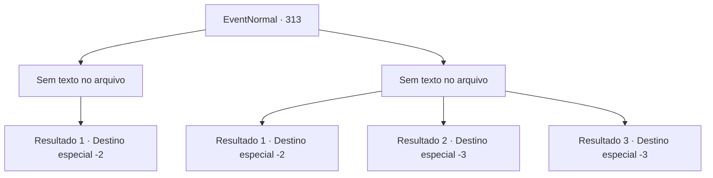

# Eventos normais · 313

[Índice da tabela](index.md) · [Índice geral](../index.md)

ID: `pt:EventNormal:313` · Fonte: `EventNormal4` · Versão: 1.2.47.

Mapeamento estático dos arquivos; a disponibilidade e a execução dependem do estado da run.

## Texto do evento

*Sem texto no arquivo.*

## Dados de entrada

```json
{
  "id": 313,
  "grade": 1,
  "place": "",
  "required": ""
}
```

## Mapa das escolhas



## Escolhas e resultados

### Escolha 1

*Sem texto no arquivo; o papel dessa opção depende da interface do jogo.*

Requisitos e outros campos da escolha:

```json
{
  "required": ""
}
```

#### Resultado 1.1

Você dá uma surra severa no anão e chuta o traseiro dele como finalizador. Ele sai mancando de você, correndo para longe, e você grita para as costas dele: 'Não ouse mostrar seu rosto por aqui novamente'. Marley, testemunhando toda a cena, agradece a você. 

 "Obrigado. Leve este escudo com você. Meus dias serão mais tranquilos por um tempo agora."

 Ela faz uma expressão aliviada e entrega o escudo para você. Você se despede dela e sai da ferraria.

Continuação registrada: [Destino especial `-2`](../destinos-especiais.md).

```json
{
  "required": "",
  "chance": "1",
  "nextEvent": -2,
  "type": 2,
  "reward": "0_3_-1|3_209_1|5_201_9"
}
```

### Escolha 2

*Sem texto no arquivo; o papel dessa opção depende da interface do jogo.*

Requisitos e outros campos da escolha:

```json
{
  "required": ""
}
```

#### Resultado 2.1

Você é derrotado pelo anão treinado na forja e acaba fugindo pela sua vida. Às suas costas, o anão grita 'Não ouse mostrar seu rosto por aqui novamente!'

Continuação registrada: [Destino especial `-2`](../destinos-especiais.md).

```json
{
  "required": "1_0_2|1_1_2",
  "chance": "1",
  "nextEvent": -2,
  "type": 2,
  "reward": "0_0_-1|0_1_-1|5_201_9"
}
```

#### Resultado 2.2

Você é atingido na cabeça com o martelo de forja do anão e perde a consciência.

Continuação registrada: [Destino especial `-3`](../destinos-especiais.md).

```json
{
  "required": "2_0_2",
  "chance": "1",
  "nextEvent": -3,
  "type": 2,
  "reward": "0_0_-1|0_1_-1"
}
```

#### Resultado 2.3

Você é atingido na cabeça com o martelo de forja do anão e perde a consciência.

Continuação registrada: [Destino especial `-3`](../destinos-especiais.md).

```json
{
  "required": "2_1_2",
  "chance": "1",
  "nextEvent": -3,
  "type": 2,
  "reward": "0_0_-1|0_1_-1"
}
```

## Referências que chegam a este evento

- [Evento 312 · escolha 1 · resultado 1](0312.md#escolha-1)
