# Eventos normais · 314

[Índice da tabela](index.md) · [Índice geral](../index.md)

ID: `pt:EventNormal:314` · Fonte: `EventNormal4` · Versão: 1.2.47.

Mapeamento estático dos arquivos; a disponibilidade e a execução dependem do estado da run.

## Texto do evento

|drawing_harbor| Você visita Levantium novamente, O porto ainda está cheio de navios mercantes, e o que costumava ser a Viúva do Amor agora tem um nome e uma cor diferentes. Logo, você sente alguém batendo em seu ombro. Quando você olha, um homem barbudo sorri, mostrando os dentes. 

 "Agora... esta é uma pessoa que estou feliz em ver novamente!!"

 

## Dados de entrada

```json
{
  "id": 314,
  "grade": 2,
  "place": "",
  "required": "5_209_1"
}
```

## Mapa das escolhas

```mermaid
flowchart TD
  E["EventNormal · 314"]
  C0["Você é o &#x27;Cabeludo&#x27;?"]
  E --> C0
  R0_0["Resultado 1 · EventNormal 315"]
  C0 --> R0_0
  C1["Desculpe, mas nós...?"]
  E --> C1
  R1_0["Resultado 1 · EventNormal 315"]
  C1 --> R1_0
```



## Escolhas e resultados

### Escolha 1

Você é o 'Cabeludo'?

Requisitos e outros campos da escolha:

```json
{
  "required": "1_7_10"
}
```

#### Resultado 1.1

No curto intervalo de tempo, você o lembra como o cozinheiro na Viúva do Amor. Você realmente não teve chance de vê-lo, já que ele sempre ficava preso dentro da cozinha, mas você decide agir como se o conhecesse, já que ele gentilmente o cumprimentou primeiro. Ele aperta sua mão, falando. 

 "Consegui deixar a vida de marinheiro graças a você. E finalmente tenho minha própria loja. O que acha? Gostaria de tomar uma bebida no local?"


Continuação registrada: [Evento 315](0315.md) na mesma tabela.

```json
{
  "required": "",
  "chance": "1",
  "nextEvent": 315,
  "type": 2,
  "reward": "5_209_2"
}
```

### Escolha 2

Desculpe, mas nós...?

Requisitos e outros campos da escolha:

```json
{
  "required": ""
}
```

#### Resultado 2.1

Você não consegue se lembrar de quem ele é. Ele parece desapontado e fala. 

 "Agora isso é triste. Eu sou o 'Hairy', o cozinheiro. Nós estávamos juntos na Viúva do Amor?"

 Você ainda não consegue se lembrar da existência dele, apesar de sua introdução. Ele ainda parece feliz em conhecê-lo, enquanto aperta suas mãos, falando. 

 "Consegui deixar a vida de marinheiro graças a você. E finalmente tenho minha própria loja. Como está? Gostaria de tomar uma bebida no local?"


Continuação registrada: [Evento 315](0315.md) na mesma tabela.

```json
{
  "required": "",
  "chance": "1",
  "nextEvent": 315,
  "type": 2,
  "reward": "5_209_2"
}
```

## Referências que chegam a este evento

Nenhum `nextEvent` positivo da mesma tabela aponta para este nó. Isso não prova que seja inacessível: sorteio e estado de história podem selecioná-lo.

