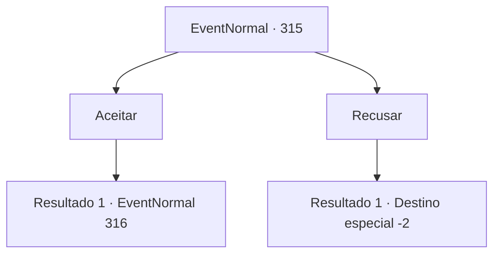

# Eventos normais · 315

[Índice da tabela](index.md) · [Índice geral](../index.md)

ID: `pt:EventNormal:315` · Fonte: `EventNormal4` · Versão: 1.2.47.

Mapeamento estático dos arquivos; a disponibilidade e a execução dependem do estado da run.

## Texto do evento

*Sem texto no arquivo.*

## Dados de entrada

```json
{
  "id": 315,
  "grade": 1,
  "place": "",
  "required": ""
}
```

## Mapa das escolhas



## Escolhas e resultados

### Escolha 1

Aceitar

Requisitos e outros campos da escolha:

```json
{
  "required": ""
}
```

#### Resultado 1.1

Você o segue até a sua loja, 'Restaurante Harbor'. Ele te leva até a sua cadeira e vai para a cozinha. Logo em seguida, ele sai com uma panela cheia de frutos do mar assados e se senta em frente a você. 

 "Agora, eu não vou pedir o seu dinheiro, então aproveite à vontade."

 Assim que ele termina, ele enche a boca com mariscos. Ele continua a te perguntar sobre a sua vida, com a boca ainda cheia de comida.

Continuação registrada: [Evento 316](0316.md) na mesma tabela.

```json
{
  "required": "",
  "chance": "1",
  "nextEvent": 316,
  "type": 2,
  "reward": ""
}
```

### Escolha 2

Recusar

Requisitos e outros campos da escolha:

```json
{
  "required": ""
}
```

#### Resultado 2.1

Você se recusa. 

 "Hmm... Acho que você está ocupado. Tudo bem então. Vamos ver... você disse que é um aventureiro..."

 Ele pede para você esperar um minuto, voltando para o seu lugar, o 'Restaurante do Porto'. Logo, ele sai com um arpão na mão, que ele entrega para você. 

 "Isso é algo que eu costumava usar, mas é bem resistente. Costumava me proteger dos mares agitados. Agora, adeus para você!"

 Ele dá tapinhas no seu ombro com suas mãos grandes e volta para o restaurante. Você pega o arpão e coloca na sua bolsa.

Continuação registrada: [Destino especial `-2`](../destinos-especiais.md).

```json
{
  "required": "",
  "chance": "1",
  "nextEvent": -2,
  "type": 2,
  "reward": "3_162_1"
}
```

## Referências que chegam a este evento

- [Evento 314 · escolha 1 · resultado 1](0314.md#escolha-1)
- [Evento 314 · escolha 2 · resultado 1](0314.md#escolha-2)
