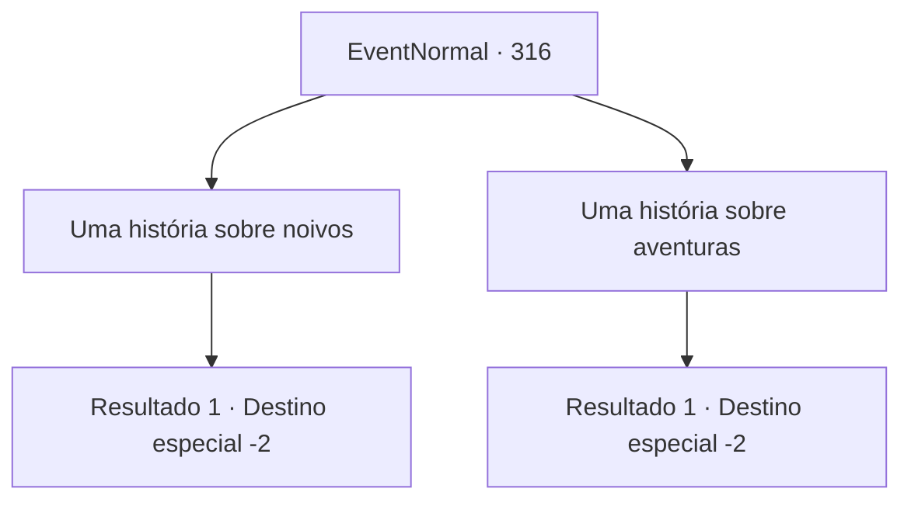

# Eventos normais · 316

[Índice da tabela](index.md) · [Índice geral](../index.md)

ID: `pt:EventNormal:316` · Fonte: `EventNormal4` · Versão: 1.2.47.

Mapeamento estático dos arquivos; a disponibilidade e a execução dependem do estado da run.

## Texto do evento

*Sem texto no arquivo.*

## Dados de entrada

```json
{
  "id": 316,
  "grade": 1,
  "place": "",
  "required": ""
}
```

## Mapa das escolhas



## Escolhas e resultados

### Escolha 1

Uma história sobre noivos

Requisitos e outros campos da escolha:

```json
{
  "required": "23_1_1"
}
```

#### Resultado 1.1

Hairy sorri felizmente, ouvindo sua história. 

 "Ah, vejo que você está no seu momento mais feliz...! Minha esposa está..."

 Ele para de falar, fechando a boca. Você percebe que é por causa do olhar afiado vindo da cozinha. Hairy termina sua frase de forma descuidada com 'de qualquer maneira' e coloca mais peixe na boca. Então, o Primeiro Oficial, 'o Rato', senta ao seu lado. Ele sorri de forma constrangedora e fala com você. 

 "Há quanto tempo não nos vemos."

 De acordo com ele, depois de vender o navio, ele começou a loja junto com o Hairy. Ele diz que começou com alguns trabalhos diversos (como limpeza e lidar com clientes bagunceiros). Depois da calorosa recepção de Hairy e Rato, você sai do restaurante de barriga cheia. 

 "Agora, agora. Olhe para mim."

 Hairy, que te acompanhou até fora, pede para você esperar um minuto, voltando para a loja. Ele está segurando um arpão nas mãos, que ele te entrega. 

 "Isso é algo que eu costumava usar, mas é bem resistente. Costumava me proteger dos mares agitados. Agora, adeus para você!"

 Ele te dá tapinhas no ombro com suas mãos grandes e retorna ao restaurante. Você pega o arpão e coloca na sua bolsa.

Continuação registrada: [Destino especial `-2`](../destinos-especiais.md).

```json
{
  "required": "",
  "chance": "1",
  "nextEvent": -2,
  "type": 2,
  "reward": "3_162_1|0_0_1|0_1_1"
}
```

### Escolha 2

Uma história sobre aventuras

Requisitos e outros campos da escolha:

```json
{
  "required": ""
}
```

#### Resultado 2.1

Hairy parece surpreso, ouvindo suas histórias. 

 "Diabos...! Eu vivi minha vida apenas nos mares... uma vida de aventureiro parece legal!"

 Então, o Primeiro Imediato, 'o Rato', senta-se ao seu lado. Ele sorri de forma constrangida e fala com você. 

 "Há quanto tempo não nos vemos."

 De acordo com ele, depois de vender o navio, ele começou a loja junto com o Hairy. Ele diz que começou com alguns trabalhos diversos (como limpeza e lidar com clientes barulhentos). Depois da calorosa recepção de Hairy e Rato, você sai do restaurante de barriga cheia. 

 "Agora, agora. Olhe para mim."

 Hairy, que te acompanhou até fora, pede para você esperar um minuto, voltando para a loja. Ele está segurando um arpão em suas mãos, que ele te entrega. 

 "Isso é algo que eu costumava usar, mas é bem resistente. Costumava me proteger dos mares agitados. Agora, adeus para você!"

 Ele te dá um tapinha no ombro com suas mãos grandes e retorna para o restaurante. Você pega o arpão e coloca na sua bolsa.

Continuação registrada: [Destino especial `-2`](../destinos-especiais.md).

```json
{
  "required": "",
  "chance": "1",
  "nextEvent": -2,
  "type": 2,
  "reward": "3_162_1|0_0_1|0_1_1"
}
```

## Referências que chegam a este evento

- [Evento 315 · escolha 1 · resultado 1](0315.md#escolha-1)
