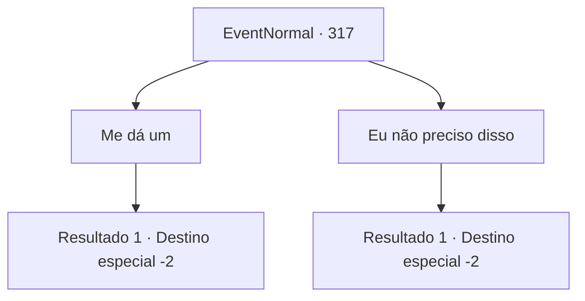

# Eventos normais · 317

[Índice da tabela](index.md) · [Índice geral](../index.md)

ID: `pt:EventNormal:317` · Fonte: `EventNormal4` · Versão: 1.2.47.

Mapeamento estático dos arquivos; a disponibilidade e a execução dependem do estado da run.

## Texto do evento

Enquanto vagava pela cidade, você encontra um menino vendendo papéis cheios de palavras. Quando você pergunta o que ele está vendendo, ele puxa o boné e fala. 

 "Isso se chama notícias, aventureiro! Elas espalham a palavra sobre coisas famosas em todo o mundo!"

 Dizendo isso, ele oferece a você um de seus jornais.

## Dados de entrada

```json
{
  "id": 317,
  "grade": 1,
  "place": "",
  "required": "18_153_1|5_217_0"
}
```

## Mapa das escolhas



## Escolhas e resultados

### Escolha 1

Me dá um

Requisitos e outros campos da escolha:

```json
{
  "required": "1_4_10"
}
```

#### Resultado 1.1

Você entrega a ele o ouro e lê o jornal. A primeira página tem uma história sobre a princesa do Império de Zaipent se apaixonando pelo bibliotecário real, visitando a biblioteca todos os dias. O menino sorri alegremente e fala. 

 "História de amor assim vende como pão quente!"

 Depois de ler tudo, você coloca o jornal na lixeira e volta para as ruas.

Continuação registrada: [Destino especial `-2`](../destinos-especiais.md).

```json
{
  "required": "",
  "chance": "1",
  "nextEvent": -2,
  "type": 2,
  "reward": "0_4_-10|5_217_1"
}
```

### Escolha 2

Eu não preciso disso

Requisitos e outros campos da escolha:

```json
{
  "required": ""
}
```

#### Resultado 2.1

Você decide não pegar o jornal. O menino não presta mais atenção em você e começa a gritar com outros pedestres. 

 "Notícias! Leia sobre coisas novas acontecendo ao redor do mundo!"


Continuação registrada: [Destino especial `-2`](../destinos-especiais.md).

```json
{
  "required": "",
  "chance": "1",
  "nextEvent": -2,
  "type": 2,
  "reward": "5_217_1"
}
```

## Referências que chegam a este evento

Nenhum `nextEvent` positivo da mesma tabela aponta para este nó. Isso não prova que seja inacessível: sorteio e estado de história podem selecioná-lo.

