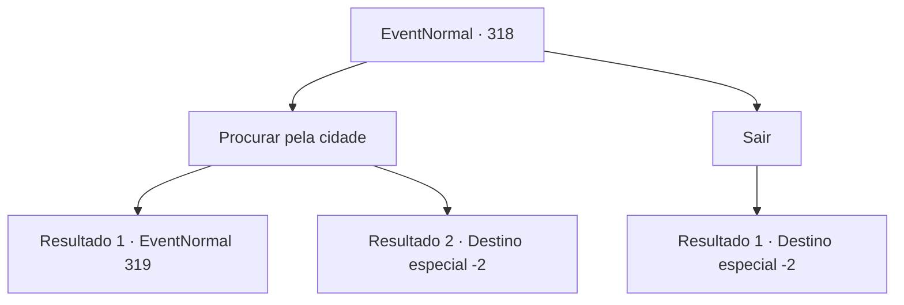

# Eventos normais · 318

[Índice da tabela](index.md) · [Índice geral](../index.md)

ID: `pt:EventNormal:318` · Fonte: `EventNormal4` · Versão: 1.2.47.

Mapeamento estático dos arquivos; a disponibilidade e a execução dependem do estado da run.

## Texto do evento

Você passa por uma pequena cidade nas montanhas. Mas você percebe que a atmosfera da cidade é um pouco estranha. É muito quieto, e o cheiro forte de sangue toca seu nariz. 

## Dados de entrada

```json
{
  "id": 318,
  "grade": 1,
  "place": "",
  "required": "1_2_20|5_221_0"
}
```

## Mapa das escolhas



## Escolhas e resultados

### Escolha 1

Procurar pela cidade

Requisitos e outros campos da escolha:

```json
{
  "required": ""
}
```

#### Resultado 1.1

Enquanto olha ao redor da cidade, você percebe que há símbolos mágicos espalhados pelos prédios, desenhados com um líquido vermelho escuro, levando a uma única direção. O símbolo tem a forma de um crânio coberto por o que parece ser videiras de árvores negras, e ao reviver suas memórias, você se lembra que é um tipo de feitiço maligno, absorvendo a força vital das pessoas dentro. Os símbolos parecem ter sido desenhados artificialmente, apenas alguns dias atrás. Você dá uma olhada dentro de portas ou janelas abertas, nos interiores dos prédios. As pessoas dentro dos prédios estão todas secas como se estivessem desnutridas, aparentemente inconscientes.

Continuação registrada: [Evento 319](0319.md) na mesma tabela.

```json
{
  "required": "",
  "chance": "1|0_7_1",
  "nextEvent": 319,
  "type": 0,
  "reward": ""
}
```

#### Resultado 1.2

Olhando ao redor da cidade, você percebe que alguns tipos de símbolos estão desenhados entre os prédios, mas não consegue discernir para que servem. Você passa pela cidade estranhamente silenciosa.

Continuação registrada: [Destino especial `-2`](../destinos-especiais.md).

```json
{
  "required": "",
  "chance": "12",
  "nextEvent": -2,
  "type": 1,
  "reward": "5_221_9"
}
```

### Escolha 2

Sair

Requisitos e outros campos da escolha:

```json
{
  "required": ""
}
```

#### Resultado 2.1

Sentindo perigo, você vira as costas para a cidade e vai embora.

Continuação registrada: [Destino especial `-2`](../destinos-especiais.md).

```json
{
  "required": "",
  "chance": "1",
  "nextEvent": -2,
  "type": 2,
  "reward": "5_221_9"
}
```

## Referências que chegam a este evento

Nenhum `nextEvent` positivo da mesma tabela aponta para este nó. Isso não prova que seja inacessível: sorteio e estado de história podem selecioná-lo.

