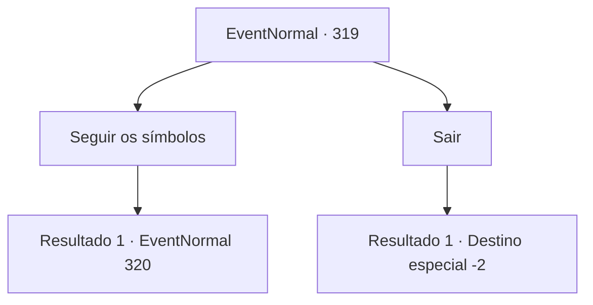

# Eventos normais · 319

[Índice da tabela](index.md) · [Índice geral](../index.md)

ID: `pt:EventNormal:319` · Fonte: `EventNormal4` · Versão: 1.2.47.

Mapeamento estático dos arquivos; a disponibilidade e a execução dependem do estado da run.

## Texto do evento

*Sem texto no arquivo.*

## Dados de entrada

```json
{
  "id": 319,
  "grade": 1,
  "place": "",
  "required": ""
}
```

## Mapa das escolhas



## Escolhas e resultados

### Escolha 1

Seguir os símbolos

Requisitos e outros campos da escolha:

```json
{
  "required": ""
}
```

#### Resultado 1.1

Você segue os símbolos. O rastro termina em frente a uma pequena cabana de troncos. Você empurra a porta e entra. A porta range ao abrir, e você vê um homem de meia-idade parado lá dentro. Todo o seu corpo está ensopado de sangue, e no centro da casa há um círculo mágico, também desenhado com sangue. Dentro do círculo mágico está uma menininha. 

 "Por favor... Você pode esquecer que você viu isso?"


Continuação registrada: [Evento 320](0320.md) na mesma tabela.

```json
{
  "required": "",
  "chance": "1",
  "nextEvent": 320,
  "type": 2,
  "reward": ""
}
```

### Escolha 2

Sair

Requisitos e outros campos da escolha:

```json
{
  "required": ""
}
```

#### Resultado 2.1

Sentindo perigo, você vira as costas para a cidade e vai embora.

Continuação registrada: [Destino especial `-2`](../destinos-especiais.md).

```json
{
  "required": "",
  "chance": "1",
  "nextEvent": -2,
  "type": 2,
  "reward": "5_221_9"
}
```

## Referências que chegam a este evento

- [Evento 318 · escolha 1 · resultado 1](0318.md#escolha-1)
